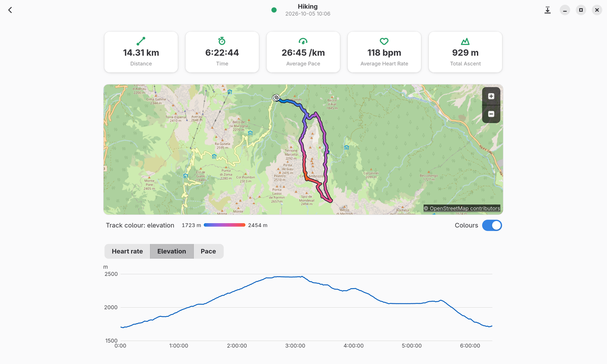
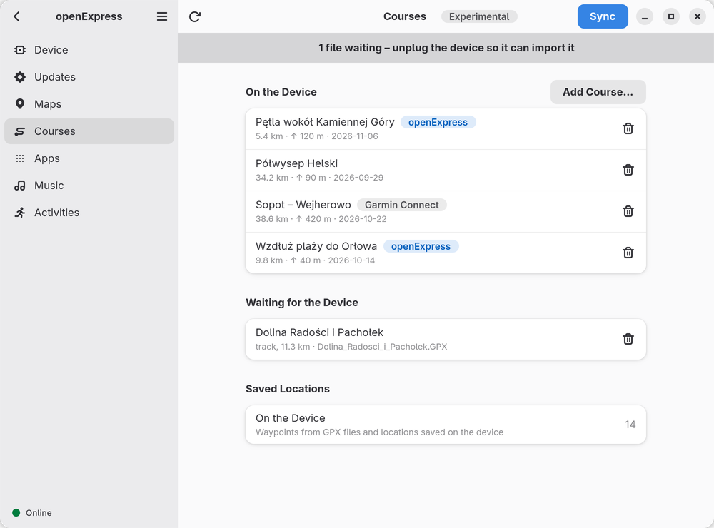
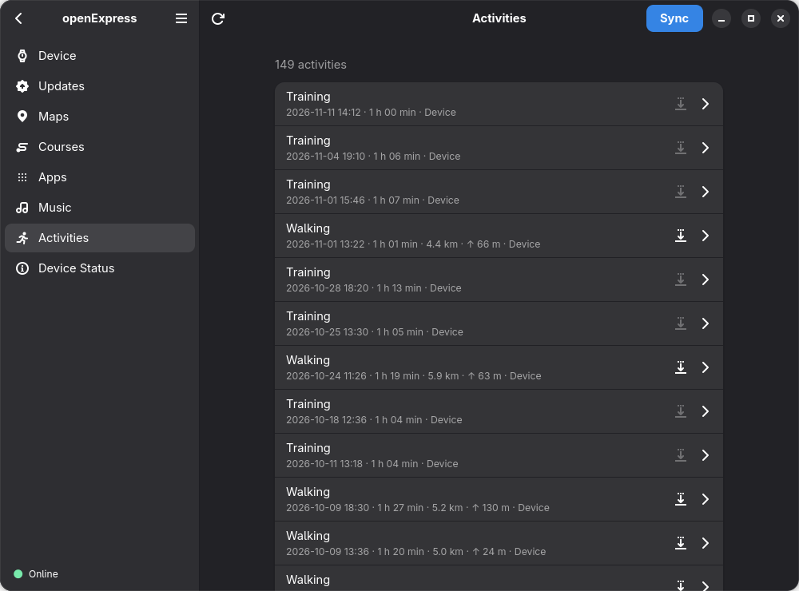

<p align="center">
  
</p>

<h1 align="center">openExpress</h1>

<p align="center">
  An unofficial Linux app for Garmin watches and bike computers: sync with Garmin Connect,
  software updates, maps, Connect IQ apps and music over USB.
  <br><a href="https://openexpress.bojanowski.me">openexpress.bojanowski.me</a>
</p>

<p align="center">
  <b>New: courses from GPX files</b> (experimental). Choose a GPX file, openExpress copies it to
  the watch or bike computer, and the device turns it into a course when you unplug it – no
  Garmin Connect needed. <a href="docs/guide.md#courses">How it works</a>.
</p>

<p align="center">
  Featured in <a href="https://the5krunner.com/2026/10/17/openexpress-garmin-express-linux/">the5krunner's Indie Spotlight</a>
</p>

<p align="center">
  <a href="https://github.com/TomaszBojanowski/openExpress/releases/latest"></a>
  <a href="LICENSE"></a>
  <a href="https://the5krunner.com/2026/10/17/openexpress-garmin-express-linux/"></a>
</p>

<p align="center">
  <picture>
    <source media="(prefers-color-scheme: dark)" srcset="docs/screenshots/activity.png">
    
  </picture>
</p>

> **openExpress is not affiliated with, endorsed by or supported by Garmin Ltd.**
> Garmin, fēnix, Garmin Connect and Garmin Express are trademarks of Garmin Ltd. or its
> subsidiaries. openExpress talks to the same Garmin services as the official Windows/macOS
> app; Garmin may change them at any time. Use at your own risk.

## What it is

Garmin Express exists only for Windows and macOS. openExpress is an independent
implementation for Linux with its own code: how the Garmin services and the watch's files
work was learned by analysing the official application, solely to interoperate with them.
It contains no Garmin code; the application key and the value that signs download addresses
are read from **your own copy** of the official installer during setup.

**Status:** beta. The main features work and are tested on the devices below; other Garmin
devices that connect over USB (MTP) should work too – reports are welcome.

- Sync with Garmin Connect: new activities, sleep, HRV and other data go up; courses,
  workouts and Connect IQ apps queued in Connect come down to the watch; TrueUp. A device not
  yet on your account can be added from openExpress (experimental).
- Software updates and free maps (TopoActive, CourseView, Ski…), installed and updated,
  checked by MD5 before they are written, and maps of your own.
- Courses from GPX files (experimental): copied to the device, which turns them into courses when
  it is unplugged, without Garmin Connect; listed and removed.
- Connect IQ apps: install, update, remove, turn on or off, put back in order – also on
  watches that hide their app folder (e.g. the fēnix 8).
- Music, podcasts and audiobooks, with playlists.
- Activities of the watch and of its backups, each with its own page: the track on a map
  (streets from OpenStreetMap after a yes) coloured by heart rate, pace or elevation, charts,
  laps, heart rate zones, training effect and details; exported as GPX, a look into any FIT
  file and a look into what a sync will write to the watch (checked on a fēnix 8 over MTP).
- The data screens of the device's activity profiles, read only: their fields in Garmin's
  words, their layouts and built-in screens.
- Backups, copies of the device's diagnostic files on this computer, the primary training
  device and the primary wearable.
- A GTK 4 / libadwaita window, a command-line tool and sync in the background.
- No telemetry. English, Polish and German.

<p align="center">
  <picture>
    <source media="(prefers-color-scheme: dark)" srcset="docs/screenshots/courses.png">
    
  </picture>
</p>

<p align="center">
  <picture>
    <source media="(prefers-color-scheme: dark)" srcset="docs/screenshots/profile.png">
    
  </picture>
</p>

<p align="center">
  
</p>

## Supported devices

| Device | Connection | Checked by |
|---|---|---|
| fēnix 8 (47 mm, Solar) | MTP | the developer; [#13](https://github.com/TomaszBojanowski/openExpress/issues/13) |
| Edge 1050 | MTP | the developer |
| Varia RTL515 | USB drive | the developer; [#9](https://github.com/TomaszBojanowski/openExpress/issues/9) |
| epix (Gen 2) | MTP | the developer (read-only: another account) |
| Venu 2 | MTP | the developer (added with Add to Account; not synced) |
| fēnix 8 (47 mm, AMOLED) | MTP | [#4](https://github.com/TomaszBojanowski/openExpress/issues/4) |
| fēnix 8 (51 mm, AMOLED) | MTP | [#14](https://github.com/TomaszBojanowski/openExpress/issues/14) |
| fēnix 7 (Sapphire Dual Power) | MTP | [#6](https://github.com/TomaszBojanowski/openExpress/issues/6) |
| fēnix 7X (Sapphire Solar), fēnix 7S (Sapphire) | MTP | users on Reddit |
| fēnix 5X | MTP | [#27](https://github.com/TomaszBojanowski/openExpress/issues/27) |
| Instinct 3 – 45mm Tactical | MTP | [#21](https://github.com/TomaszBojanowski/openExpress/issues/21) |
| Edge 1040 | MTP | [#8](https://github.com/TomaszBojanowski/openExpress/issues/8), [#10](https://github.com/TomaszBojanowski/openExpress/issues/10) |
| Edge 540 | MTP | [#18](https://github.com/TomaszBojanowski/openExpress/issues/18), [#28](https://github.com/TomaszBojanowski/openExpress/issues/28) |
| inReach Mini 2 | USB drive | [#11](https://github.com/TomaszBojanowski/openExpress/issues/11) |
| Forerunner 55 | USB drive | [#19](https://github.com/TomaszBojanowski/openExpress/issues/19) |
| Forerunner 920XT | USB drive | [#20](https://github.com/TomaszBojanowski/openExpress/issues/20) |
| Instinct 2S Solar | USB drive | [#24](https://github.com/TomaszBojanowski/openExpress/issues/24) |
| zūmo 595LM | – | [#15](https://github.com/TomaszBojanowski/openExpress/issues/15) |
| Other Garmin watches and bike computers over USB (MTP) | MTP | expected to work, **untested** |

What works on each, and the reports in full: [Supported devices](docs/devices.md). A device
that connects as a USB drive gets its information, software updates and backups; a watch in
this mode is also synced, both ways, with the Sync button or `openexpress sync` (confirmed on
an Instinct 2S, [#24](https://github.com/TomaszBojanowski/openExpress/issues/24): more reports
welcome). Apps, maps and music are for MTP devices only.

## Install

```bash
flatpak remote-add --user --if-not-exists flathub https://dl.flathub.org/repo/flathub.flatpakrepo
flatpak remote-add --user --if-not-exists bojanowski https://flatpak.bojanowski.me/bojanowski.flatpakrepo
flatpak install --user bojanowski io.github.tomaszbojanowski.OpenExpress
```

Updates then come with `flatpak update`. The GNOME runtime comes from Flathub, hence the
first line. If you added this repository earlier under the name `openexpress`, keep it: it is
the same repository and keeps updating. Not using Flatpak, or installing offline:
[Other ways to install](docs/install.md).

### The Flatpak and the version from source

They keep their own setup, sign-in and records. The version from source also reads what the
Flatpak keeps of a device: a file the Flatpak uploaded is not uploaded again, and the two never
sync at the same time. The Flatpak cannot see the version from source
([more](docs/install.md#the-flatpak-and-the-version-from-source)).

### System requirements

openExpress reads devices that connect over MTP (most watches and bike computers) through
gvfs, as GNOME's file manager does; the Flatpak uses the gvfs of your system. gvfs needs its
MTP backend:

- Fedora: `sudo dnf install gvfs-mtp`
- Arch and distributions based on it (e.g. CachyOS, Manjaro): `sudo pacman -S gvfs-mtp`
- Debian, Ubuntu: `sudo apt install gvfs-backends`

GNOME comes with it; KDE Plasma and other desktops often do not. Log out and back in after
installing it. Without it, the window says **No MTP Support in the System (gvfs-mtp)** as soon
as a device is plugged in, and the command line says the same. Devices in mass storage mode
(such as the Varia RTL515) need no MTP.

**KDE Plasma and Dolphin:** Dolphin opens MTP devices through KDE's own MTP service (kmtpd
from kio-extras, in the `kiod6` process), which keeps the device, so the window says
**Device Not Ready**. Close Dolphin, run `kquitapp6 kiod6`, then unplug the cable and
plug it back in ([more](docs/troubleshooting.md#kde-plasma-and-dolphin)).

## Getting started

1. Download the Garmin Express installer **for Windows** (`GarminExpress.exe`, free from
   [garmin.com](https://www.garmin.com/en-US/software/express/windows/)) – also without
   Windows: openExpress only reads it. The installer for macOS does not work.
2. Open openExpress from your application menu.
3. Connect the watch. On its page, click **Choose Installer…** in the banner and select the
   installer, then **Sign In**. No key needs to be created in Garmin Connect.
4. Sync. The first sync asks whether to upload everything on the watch or new data only.
5. To sync whenever the watch is connected, turn on **Background Sync** on its page.

How the window works: [Usage](docs/guide.md).

## Command line

The same as commands: `flatpak run io.github.tomaszbojanowski.OpenExpress <command>`, or
`openexpress <command>` from source – for example `sync`, `updates` or `maps`. A command that
changes anything only shows its plan until you add `--apply`. Every command:
[Command line](docs/cli.md).

## Limitations

- Connect IQ app settings (their form is rendered by apps.garmin.com).
- Apps, maps and music for devices that connect as a USB drive, and their sync in the
  background (they are synced with the Sync button or the command line only).
- Map updates for devices whose maps Garmin serves another way than its universal map
  service, and maps on a memory card.
- GPS satellite data (ephemerides) and ECG recordings (they need Garmin Health's own
  sign-in).
- Software updates are installed when you choose to, never as part of a sync.

## Privacy

- The password is typed only on Garmin's page; openExpress keeps a login token in a file only
  you can read.
- No telemetry. The watch's diagnostics are uploaded only with `--include-diagnostics`, and
  the copies of its diagnostic files stay on this computer.
- Sync never deletes files from the watch, and every file written to it is checked.
- The log never has serial numbers, unit IDs, tokens or e-mail addresses.
- The map of an activity asks OpenStreetMap for its streets only after you turn them on; the
  server then learns the area of each map you look at and your IP address, never the activity,
  its track or your account.

More: [Privacy and security](docs/privacy.md).

### Flatpak permissions

Besides a window and the network, the Flatpak may run `gio copy` on the host (gvfs lets no
sandboxed app write to MTP devices), open USB devices (`--device=usb`: Connect IQ apps on
watches that hide their app folder) and use the drives mounted under `/run/media` and `/media`
(devices in mass storage mode). What each is for and how to turn it off:
[Flatpak permissions](docs/privacy.md#flatpak-permissions).

## Support

Tried openExpress with another device, or something does not work? Please send a
[device report](https://github.com/TomaszBojanowski/openExpress/issues/new?template=device_report.yml) –
also when everything works. In the window: main menu (☰) → **Report a Device or Problem…**;
on the command line: `openexpress report`, and `openexpress report --log` for the log. The
report has no serial number, unit ID or e-mail. Do not post the output of `openexpress info`,
your `GarminDevice.xml` or the files in `~/.config/openexpress`. When something goes wrong:
[Troubleshooting](docs/troubleshooting.md).

## Help translate

<a href="https://hosted.weblate.org/projects/openexpress/"></a>

openExpress speaks English, Polish and German. To add your language or correct one, translate it
in your browser on [Hosted Weblate](https://hosted.weblate.org/projects/openexpress/), or send a
`.po` file in a pull request: [Translating openExpress](docs/translating.md).

## Documentation

- [Supported devices](docs/devices.md) – every device and what was tested, USB modes
- [Usage](docs/guide.md) – the window, software updates, maps, apps, music, sync, settings
- [Command line](docs/cli.md) – every command and option, exit codes
- [Troubleshooting](docs/troubleshooting.md) – known problems, the log, reporting a problem
- [Privacy and security](docs/privacy.md) – what is kept and sent, the Flatpak's permissions
- [Other ways to install](docs/install.md) – a bundle from a release, from source, building the Flatpak
- [Translating](docs/translating.md) – what not to translate, Garmin's words, trying a translation
- [Contributing](CONTRIBUTING.md) – tests and translations

## Thanks

- [Sommet](https://github.com/skinnie/sommet) by skinnie and
  [Activity Profile Editor](https://github.com/fullcarbonbike/Activity-Profile-Editor) by
  fullcarbonbike described the files of sport profiles that the view of data screens
  reads ([design](docs/design/ekrany-danych.md)); the names of the data fields follow the
  numbers of Activity Profile Editor's table. openExpress copies no code of Sommet
  (GPL-3.0-only); what it takes from Activity Profile Editor (MIT) keeps that project's notice
  and its author's name.
- GNOME's [icon-development-kit](https://gitlab.gnome.org/Teams/Design/icon-development-kit)
  (CC0 1.0) gave the shapes of four icons: the heart and the stopwatch (built-in screens and
  the tiles of an activity), the speedometer (pace and speed) and the sliders (Activity
  profiles); the other icons are drawn in the style of GNOME's symbolic icons.
- hutamaki found why every write to the device failed from the Flatpak on Ubuntu 22.04
  and sent the fix ([#28](https://github.com/TomaszBojanowski/openExpress/issues/28)).

## License

openExpress is free software under the [GNU General Public License v3.0 or later](LICENSE).
