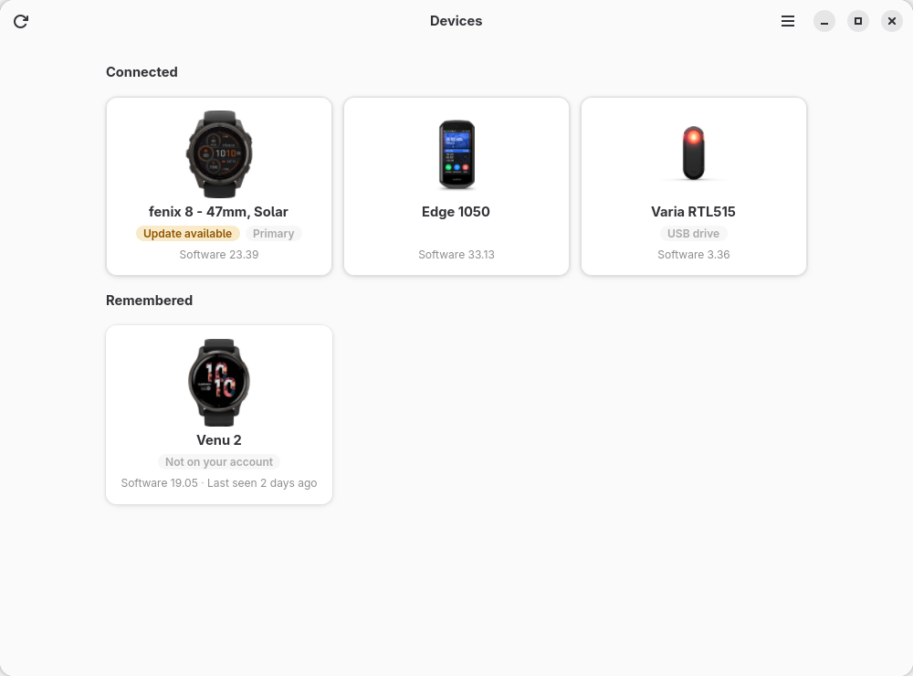
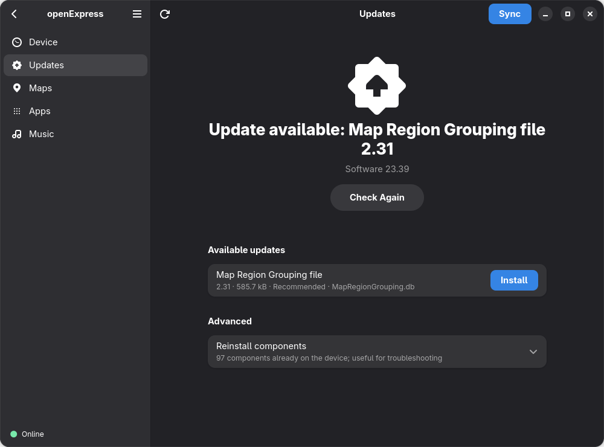
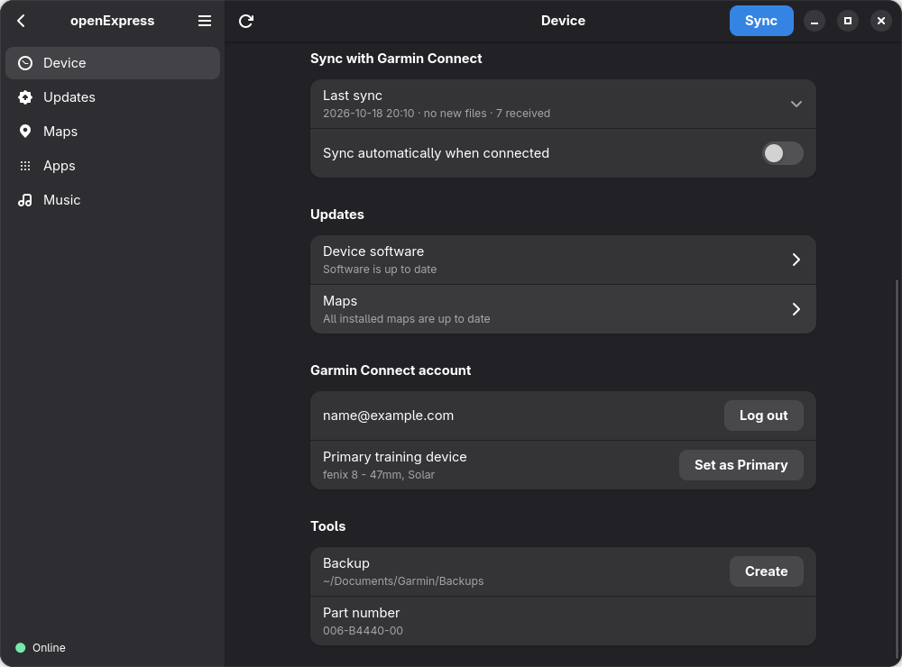
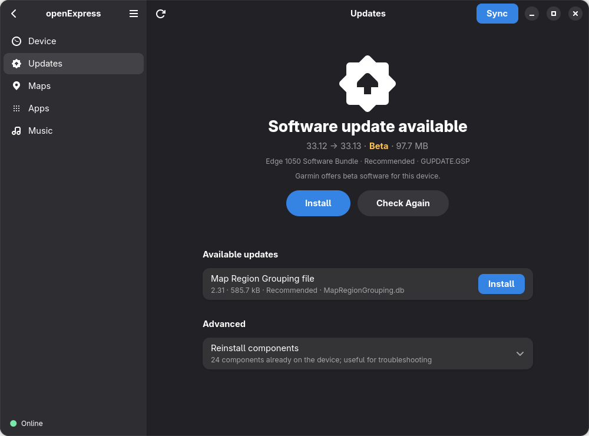
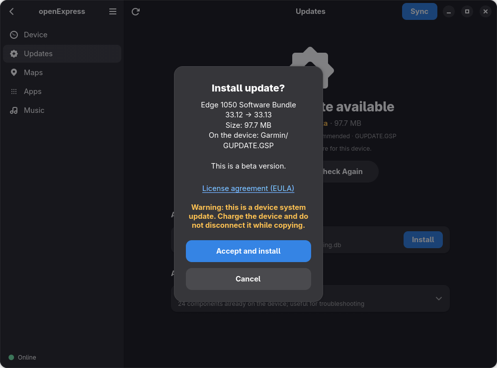
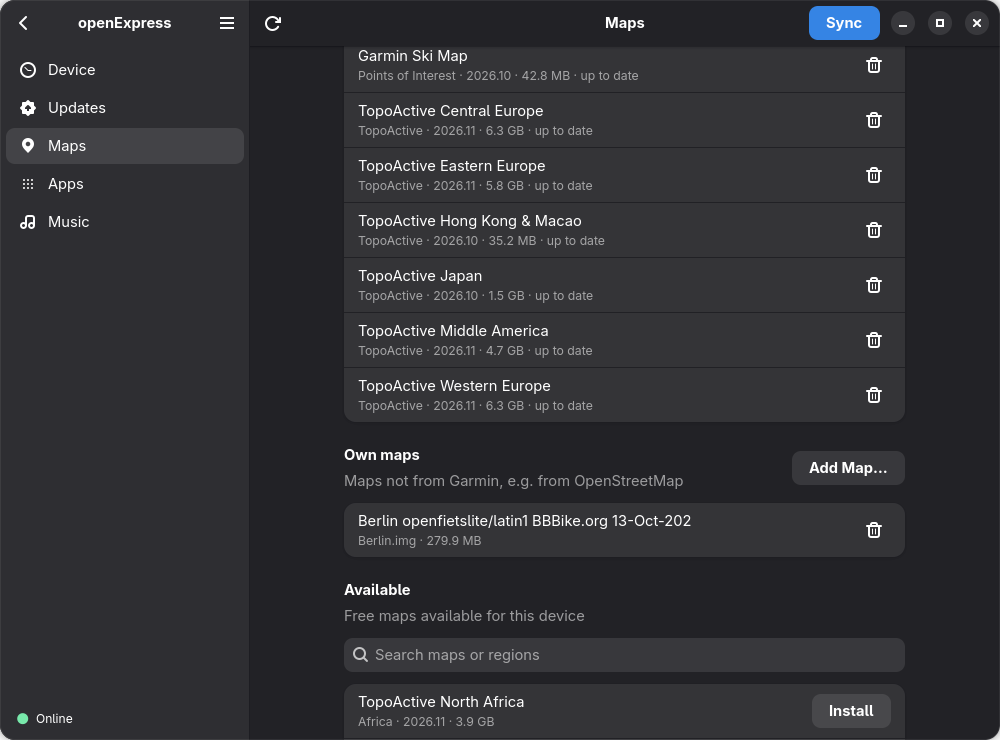
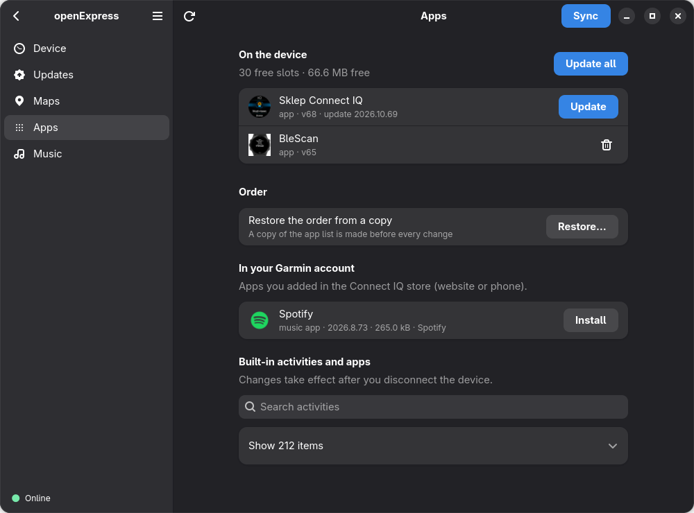
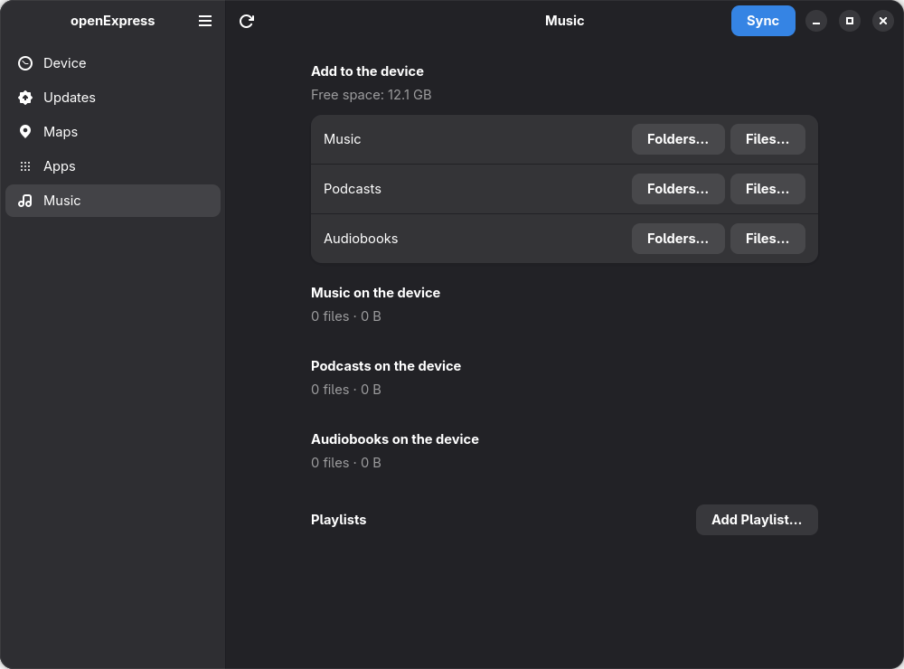

<p align="center">
  
</p>

<h1 align="center">openExpress</h1>

<p align="center">
  An unofficial Linux app for Garmin watches: sync with Garmin Connect, software updates,
  maps, Connect IQ apps and music over USB.
</p>

<p align="center">
  <picture>
    <source media="(prefers-color-scheme: dark)" srcset="docs/screenshots/start.png">
    
  </picture>
</p>

> **openExpress is not affiliated with, endorsed by or supported by Garmin Ltd.**
> Garmin, fēnix, Garmin Connect and Garmin Express are trademarks of Garmin Ltd. or its
> subsidiaries. openExpress talks to the same Garmin services as the official Windows/macOS
> app; Garmin may change them at any time. Use at your own risk.

Featured in [the5krunner's Indie Spotlight](https://the5krunner.com/2026/10/17/openexpress-garmin-express-linux/).

## Install

```bash
flatpak remote-add --user --if-not-exists flathub https://dl.flathub.org/repo/flathub.flatpakrepo
flatpak remote-add --user --if-not-exists openexpress https://flatpak.bojanowski.me/openexpress.flatpakrepo
flatpak install --user openexpress io.github.tomaszbojanowski.OpenExpress
```

Updates then come with `flatpak update`. The GNOME runtime comes from Flathub, hence the
first line; skip it if you already have Flathub. openExpress then appears in your application
menu; see [Getting started](#getting-started).

Not using Flatpak, or installing offline? See [Other ways to install](#other-ways-to-install).

### System requirements

openExpress reads devices that connect over MTP (most watches and bike computers) through
gvfs, as GNOME's file manager does; the Flatpak uses the gvfs of your system. gvfs needs its
MTP backend:

- Fedora: `sudo dnf install gvfs-mtp`
- Arch and distributions based on it (e.g. CachyOS, Manjaro): `sudo pacman -S gvfs-mtp`
- Debian, Ubuntu: `sudo apt install gvfs-backends`

GNOME comes with it; KDE Plasma and other desktops often do not. Log out and back in after
installing it. Without it, the window says **No MTP support in the system (gvfs-mtp)** as soon
as a device in its normal mode is plugged in, and the command line says the same. Devices in
mass storage mode (such as the Varia RTL515) need no MTP: the system mounts them as a drive.

**KDE Plasma and Dolphin:** Dolphin opens MTP devices through KDE's own MTP service (kmtpd
from kio-extras, in the `kiod6` process), not through gvfs. Once started, the service keeps
every MTP device it has opened, also after Dolphin is closed, and takes a device back as soon
as its cable is plugged in again, so gvfs cannot offer it; after 45 seconds the window says
**The device is not ready**. To free the device, close Dolphin, run `kquitapp6 kiod6`, then
unplug the cable and plug it back in. Open the device in openExpress rather than in Dolphin;
if you open it in Dolphin again, repeat these steps.

## Contents

- [System requirements](#system-requirements) · [Features](#features) · [Supported devices](#supported-devices)
- [Usage](#usage): [getting started](#getting-started), [window and background sync](#application-window-and-background-sync),
  [command line](#command-line), [exit codes](#exit-codes), [software updates](#software-updates),
  [maps of your own](#maps-of-your-own), [Connect IQ apps](#connect-iq-apps), [music](#music),
  [sync details](#sync-details), [troubleshooting](#troubleshooting)
- [Configuration](#configuration): [languages](#languages), [log file](#log-file), [cache](#cache),
  [privacy and security](#privacy-and-security), [Flatpak permissions](#flatpak-permissions)
- [Other ways to install](#other-ways-to-install) · [Development](#development) · [License](#license)

## Features

Garmin Express exists only for Windows and macOS. openExpress is an independent
implementation with its own code, so Linux users can manage their watch without a
virtual machine. How the Garmin services and the watch's file layout work was learned by
analysing the official application, solely to make openExpress interoperate with them.
It contains no Garmin code. It does contain the names by which Garmin Express introduces
itself to Garmin's servers (its client identifiers and the values of its client headers);
the application key, its secret and the value that signs download addresses are read from
**your own copy** of the official installer during setup.

**Status:** beta. The main features work and are tested on the devices listed in
[Supported devices](#supported-devices); other Garmin devices that connect over USB (MTP)
should work, but are untested – reports are welcome. Developed on Fedora/GNOME.

- Garmin Connect sync: new activities, sleep, HRV, metrics… are uploaded; courses, workouts
  and Connect IQ apps queued in Connect are written to the watch; TrueUp for multiple devices.
- Watch software updates and free maps (TopoActive, CourseView, Ski…), with MD5 verification.
  A map Garmin does not offer in the country of your Garmin account is not installed or
  updated, and the window and `openexpress maps` say why; the country is read from the
  account's profile (Garmin Express uses the computer's IP address), and without it (not
  signed in, a device of another account) such a map is only marked.
- Connect IQ apps: install, update, remove, enable/disable built-in activities – also on
  watches that hide their app folder (e.g. the fēnix 8), without reordering your widgets.
- Music, podcasts and audiobooks with playlists.
- GTK 4 / libadwaita window, command-line tool and background sync with notifications.
- No telemetry. English and Polish, translatable with gettext.

<p align="center">
  
</p>

### Not yet available

- Connect IQ app settings (the settings form is rendered by apps.garmin.com).
- Map updates for devices that connect as a USB drive (mass storage mode), such as older
  nüvi car navigators, and for devices whose maps Garmin serves another way than its
  universal map service (the window and `openexpress maps` say so; the Maps page names
  the map update type Garmin gives the device, which helps a report).
- Checking the privacy-policy consents before a sync (the upload consent is checked, see
  [Privacy and security](#privacy-and-security)).
- GPS satellite data (ephemerides), which Garmin Express writes to the watch when it syncs
  and which helps the watch find its position faster.
- Maps on a memory card: maps are installed and updated in the device's internal memory only.
- Installing software updates as part of a sync: they are installed only when you choose
  to, on the Updates page or with `openexpress updates --install`.
- Uploading ECG recordings: they go to Garmin Health, which needs a sign-in of its own that
  openExpress does not have. A sync leaves them on the watch and says how many there are.

## Supported devices

| Device | Status |
|---|---|
| fēnix 8 (47 mm, Solar) | on the developer's Garmin account; tested by the developer: sign-in, sync (upload, TrueUp), software update download, map install, maps of your own (added from the command line and the window, removed in the window; also in the Flatpak), copying music and playlists, Connect IQ apps in the version from source (install and remove on the command line and in the window, restoring the order on the command line) and in the Flatpak with its USB permission (install and remove in the window, 15 October 2026). **Not yet tested on the watch:** updating a Connect IQ app, installing a software update |
| fēnix 8 (51 mm, AMOLED; part 006-B4536-00) | reported by a user in [#14](https://github.com/TomaszBojanowski/openExpress/issues/14) (Fedora 44, KDE on Wayland, Flatpak 0.6.19): it opens in the window; before its first Connect IQ app it has no app list (`GARMIN/APPS/OUT.BIN`), which 0.6.19 showed as an error on the Apps page; now that is no apps, and apps from the account are queued in Garmin Connect |
| epix (part 006-B3943) | read-only commands and backup tested |
| Edge 1050 | on the same account; detected automatically; read-only commands and backup tested; a sync in the window uploaded new files and wrote files from Garmin Connect to the device (15 October 2026); one system software update installed in the window (beta 33.12, 14 October 2026) |
| Venu 2 (part 006-B3703) | read-only commands tested; it was the first device to get software updates installed with openExpress (two components, Time Zone Map and Exercise to muscle mapping, 13 October 2026). The watch was not registered to the Garmin Connect account used for testing, so nothing that needs the account (sync, Connect IQ apps) was tested on it |
| fēnix 8 (47 mm, AMOLED; part 006-B4536-00) | reported by a user in [#4](https://github.com/TomaszBojanowski/openExpress/issues/4) (Linux Mint 22.3, Cinnamon on X11, Flatpak 0.6.1): detected; sign-in, checking for software updates and Garmin maps (install, update or remove) work; the watch is in Garmin's beta program |
| fēnix 7 (Sapphire Dual Power; part 006-B3909-00) | reported by a user in [#6](https://github.com/TomaszBojanowski/openExpress/issues/6) (Fedora 44, GNOME on Wayland, Flatpak 0.6.2): detected; sign-in, checking for software updates, installing a system software update, Garmin maps (install, update or remove) and maps of your own work |
| Edge 1040 (part 006-B3843-00) | reported by a user in [#8](https://github.com/TomaszBojanowski/openExpress/issues/8) (Linux Mint 22.3, Cinnamon on X11, Flatpak 0.6.1): detected; checking for software updates, installing a Garmin map (Trailforks) and installing and removing Connect IQ apps work; sync not tried |
| Varia RTL515 (part 006-B3592-03) | reported by a user in [#9](https://github.com/TomaszBojanowski/openExpress/issues/9) (Linux Mint 22.3, Cinnamon on X11, Flatpak 0.6.4): detected as a USB drive; sign-in and checking for software updates work. Also tested by the developer (Fedora 44, GNOME on Wayland, 0.7.4): shown on the start page as the remembered Varia before its drive is mounted. |
| inReach Mini 2 (part 006-B3968-00) | reported by a user in [#11](https://github.com/TomaszBojanowski/openExpress/issues/11) (Linux Mint 22.3, Cinnamon on X11, Flatpak 0.6.4): connects as a USB drive: software updates work (the device installs one once its drive is ejected properly), sync not yet ([#12](https://github.com/TomaszBojanowski/openExpress/issues/12)) |
| Edge 540 (part 006-B4061-00) | reported by a user in [#18](https://github.com/TomaszBojanowski/openExpress/issues/18) (Fedora 44, KDE on Wayland, Flatpak 0.6.20): detected; sync, software updates and maps work |
| Forerunner 55 (part 006-B3869-00) | reported by a user in [#19](https://github.com/TomaszBojanowski/openExpress/issues/19) (Fedora 44, KDE on Wayland, Flatpak 0.6.20): connects as a USB drive: software updates work, sync not yet |
| Forerunner 920XT (part 006-B1765-00) | reported by a user in [#20](https://github.com/TomaszBojanowski/openExpress/issues/20) (Fedora 44, KDE on Wayland, Flatpak 0.6.20): connects as a USB drive: software updates work (time-zone map updated), sync not yet |
| Instinct 3 – 45mm Tactical (part 006-B4585-00) | reported by a user in [#21](https://github.com/TomaszBojanowski/openExpress/issues/21) (Kubuntu 26.04, KDE on Wayland, Flatpak 0.7.0): detected; sync works, also of an activity with GPS. With Stealth mode on, the watch keeps no GPS track of an activity, so only its totals reach Garmin Connect |
| Other Garmin watches and bike computers connecting over USB (MTP) | expected to work, **untested** |

Tried openExpress with another device? Please send a
[device report](https://github.com/TomaszBojanowski/openExpress/issues/new?template=device_report.yml) –
also when everything works. In the window: main menu (☰) → **Report a Device or Problem…**
→ **Open on GitHub** opens the form with the report and a title filled in; or run
`openexpress report`, which prints the report and an address that does the same. The report
contains no serial number, unit ID or e-mail. Nothing is published until you submit the form.

### USB modes: MTP and mass storage

Devices that connect over MTP (most watches and bike computers, such as the fēnix 8 and the
Edge 1050) work in both the Flatpak and the version from source. Since 0.6, openExpress also
supports Garmin devices that connect as a USB drive (mass storage mode: some older Garmin
models, and accessories such as the Varia RTL515): their information and software updates, in
the window and on the command line, in the Flatpak and in the version from source. Both find
such a device by themselves, an MTP device first when both are connected; the window also
lists one that the system has not mounted yet (as on KDE, until a file manager opens it) and
mounts it when you choose it. `--path` is only for a folder without a device, such as a copy.
A watch in this mode switches its drive off once it is ejected: plug it in again to use it
again. Sync, apps, maps, music and backup are not
supported for such a device; the window and the commands say so. A car or motorcycle
navigator that connects as a USB drive (such as an older nüvi) therefore gets its software
updates, but no map updates. Mass storage is tested on the Varia RTL515 (on 21 October
2026 also copying a component update and ejecting the drive in the window); reports from
other devices in mass storage mode are welcome. If you are not sure which mode your device
uses, plug it in: if it appears as a USB drive in your file manager rather than through MTP,
it is in mass storage mode.

## Usage

### Getting started

openExpress appears in your application menu. Setup needs the Garmin Express installer
**for Windows** (`GarminExpress.exe`, a free download from
[garmin.com](https://www.garmin.com/en-US/software/express/windows/)), also when you have
no Windows: openExpress only reads it and installs nothing. The installer for macOS does
not work. Click **Choose Installer…** in the banner at the top and select it (later also in
Preferences → Setup → **Choose File…**), then **Log In**. Turn on automatic sync on the
Device page (or in Preferences) to sync whenever the watch is connected.

The window opens on the start page (the picture at the top): a tile for each Garmin device
connected, and for those seen before; a tile opens its device. Up to two labels on a tile say
what is waiting and what the device is: **Update available**, or **Unplug to install** (an
update copied to the connected device, which installs it once unplugged; **Eject to install**
for a USB drive), **To sync** (activities on the device not uploaded yet) or **Never synced**
(by this installation; the Flatpak and the version from source each keep their own),
**USB drive**, **Primary** (the account's **Primary wearable**, as Garmin Connect names it:
steps and sleep come from this device), **Not on your account** and,
when nothing else needs saying, **Synced** (synced before, nothing new to upload). **To
sync** and **Synced** are there at once, as the last count found them (at most 7 days ago,
and only while nothing was synced since); the count that runs then confirms or changes them.
Labels of the account come from the account's list as it was last read (at most 7 days ago,
with the same login): while you are not logged in there are none, and when the list could not
be read a sentence under the tiles says so. The device page shows **Update available** or
**Update ready** under the software version too, and, under the account's **Primary training
device**, its **Primary wearable** (read only; only for a device that can be one). Its
**Apps** and **Music** rows lead to their pages, as **Maps** does, and say how many there are
once those pages have read them; **Backup** says when the last backup was made and how many
there are (the folder in its tooltip).

A device seen before and not connected opens read-only: what was known of it when it was
last seen, its last sync with its details, what the last check of its updates found and
when (*Not checked since …* when that check is older than 30 days), and, while the
account's list is known, its **Primary wearable**. **Forget Device…** at the bottom of that
page removes what this installation keeps of it (what was uploaded from it, its last sync, the maps of your own
copied to it); connected again, it is a new device, and its first sync asks again whether to
upload everything or new data only. Files not uploaded yet go only when you tick them, its
backups only when you ask; nothing changes on the device or on your Garmin account. From the
command line: `openexpress devices --forget N`.

The command-line tool is available as
`flatpak run io.github.tomaszbojanowski.OpenExpress <command>` (for example `sync` or `maps`);
in the version from source it is `openexpress <command>`.

If the login window does not capture the ticket, use `openexpress login --manual`: you
sign in using a regular browser and paste the final URL containing `ticket=ST-…`.

### Application window and background sync

```bash
openexpress gui                       # application window
openexpress install-desktop --apply   # "openExpress" menu entry and background service
systemctl --user daemon-reload
systemctl --user enable --now openexpress-watch.service
```

The background service syncs the watch every time it is connected and shows a notification.
It does nothing until you log in and perform the first sync
(in the application window or with `openexpress baseline`/`sync`). The window and the service
never sync at the same time (shared lock). A watch that is not registered to the signed-in
account only gets a notification.

The background service leaves devices in mass storage mode alone (such as the Varia RTL515):
it neither opens nor syncs them, and shows no notification about them. It syncs only when,
apart from those, exactly one Garmin device is connected; with two or more it writes a line
in the [log](#log-file) and does nothing. A watch and a Varia: the watch is synced.

<p align="center">
  
</p>

### Command line

| Command | Description |
|---|---|
| `openexpress info` | model, software version, free space |
| `openexpress files [--type FIT_TYPE_4]` | files on the watch by data type from `GarminDevice.xml` |
| `openexpress report [--log]` | device report for GitHub, without serial numbers, unit IDs or e-mail; `--log` prints the last 200 lines of the [log](#log-file) instead, filtered, for the form's “Log” field |
| `openexpress diagnostics [--crash-logs] [--dumps] [--apply]` | what the device logged as errors, its memory dumps and the copies of its diagnostic files kept on this computer; `--apply` copies the files it shows now, `--crash-logs` also reads its hidden crash logs (the device leaves the file manager for a moment), `--dumps` also copies its memory dumps; nothing is sent (see [Privacy and security](#privacy-and-security)). `openexpress setup --diagnostics-copy on` makes the window copy them at each connection |
| `openexpress devices [--forget N] [--discard-pending] [--backups] [--apply]` | the devices this installation has seen; `--forget N` forgets device number N of the list and what this installation keeps of it (what was uploaded from it, its last sync, the maps of your own copied to it, the copies of its diagnostic files), so that connected again it is a new device; files not uploaded yet go only with `--discard-pending`, its backups only with `--backups`; a connected device is not forgotten |
| `openexpress setup --from-installer GarminExpress.exe` | one-time setup from the Garmin Express installer for Windows (only read, nothing installed) |
| `openexpress login [--manual]` | sign in on the Garmin SSO page (WebKitGTK window) |
| `openexpress whoami [--check]`, `logout` | account, log out (removes the local token) |
| `openexpress upload-config` | what data is uploaded for this watch and where (Garmin server) |
| `openexpress sync [--all] [--upload-only] [--download-only] [--type TYPE]… [--include-diagnostics] [--apply]` | uploads new FIT files to Connect, courses and workouts from Connect to the watch; `--all` uploads everything on the first sync, `--upload-only` and `--download-only` do one direction, `--type` (repeatable) only the data types named, `--include-diagnostics` also the device's diagnostics (see [Privacy and security](#privacy-and-security)) |
| `openexpress baseline [--apply]` | marks current files as already uploaded (first run) |
| `openexpress backup [--apply]` | local backup of watch data (default `~/Documents/Garmin/Backups`, last 3 kept) |
| `openexpress cache [--clear] [--only maps,updates] [--apply]` | size of the cache by part (maps, updates, pictures, temp) and clearing it (see [Cache](#cache)) |
| `openexpress updates [--reinstalls]` | watch software updates (no login needed); a file the watch already has with the same size and MD5 is not counted as an update, only listed as "already on the device" |
| `openexpress updates --install PART… [--apply]` | download with MD5 check and copy to the watch; after it is unplugged the watch may ask whether to install the update now or later, then restart |
| `openexpress maps [--all]` | installed and available maps (TopoActive, base maps, CourseView, Ski) |
| `openexpress maps install NAME [--apply]` | install a map assigned to the watch (download, activation, write) |
| `openexpress maps update [--apply]`, `maps remove NAME [--apply]` | update and remove maps |
| `openexpress maps add FILE.img [--name NAME] [--apply]` | copy a map of your own (e.g. made from OpenStreetMap data) to the device; never overwrites a file |
| `openexpress maps remove --own NAME [--apply]` | remove a map of your own that was copied with `maps add` |
| `openexpress apps [--builtin]` | Connect IQ apps on the watch and in your Garmin account, available updates |
| `openexpress apps install/update/remove/enable/disable … [--apply]` | install, update, remove, enable or disable apps and built-in activities |
| `openexpress apps order [--from COPY] [--apply]` | put apps and widgets back in the order of a saved copy of the app list |
| `openexpress primary [set --apply]` | show the account's primary training device, or make the connected device the primary one |
| `openexpress music [add PATH… \| playlist FILE.m3u \| remove TEXT…] [--apply]` | music, podcasts and audiobooks (Artist/Album layout, `.m3u8` playlists) |
| `openexpress gui` | application window (GTK 4 + libadwaita): watch, sync, updates, maps, apps, music |
| `openexpress watch` | background service: sync when the watch is connected, with a notification |
| `openexpress install-desktop [--remove] [--apply]` | application menu entry and systemd user service (version from source); `--remove` removes them |

All commands that change anything run **in dry-run mode by default**:
they show the plan and do nothing without `--apply`. The exceptions are `setup`, `login` and
`logout`, which change only openExpress's own configuration and login token, at once.

A Garmin device needs a moment to start after it is plugged in. Commands wait for it
(up to 45 seconds) and the window shows that the device is starting; `--no-wait` makes a
command fail at once instead.

While a sync, a backup or a write is running, the window shows **Do not unplug the device**
and the command-line tool prints the same warning when it starts such an operation.

### Exit codes

| Code | Meaning |
|---|---|
| 0 | done (also a dry run) |
| 1 | an error or a refusal: the device, the account, a server or the network, or a value the command checks itself (e.g. an unknown part in `cache --only`); the message says why |
| 2 | a wrong command line: an unknown command or option, a value that is not one of the choices (e.g. `setup --environment`), or a missing argument |
| 3 | the first sync with this program waits for a choice: `openexpress baseline --apply` or `openexpress sync --apply --all` |
| 130 | interrupted (Ctrl+C); not while `sync` waits for TrueUp, which Ctrl+C only stops (the sync then ends with 0) |

### Software updates

The Updates page (and `openexpress updates`) asks Garmin's update server what is new for the
connected device; no login is needed.

- **Status:** the top of the page says whether a system software update is available (with
  the installed and the new version), how many other updates there are, or that the software
  is up to date.
- **System updates are recognised by their file** (`GUPDATE.GSP`, `GUPDATE.GCD`) as well as
  by what the server says: the server does not always mark them.
- **Beta versions** that Garmin offers to a device in its beta program are marked *Beta* in
  the window and `[BETA]` on the command line.
- **Before a system update** is copied, the window and `openexpress updates --install` warn
  to charge the device and not to disconnect it while copying. The question in the window
  shows both versions and links to the license (EULA).
- **Devices that lose their data on an update:** before every update of a device that Garmin
  files as one of these kinds (Wellness and Vivomove), the window and `openexpress updates
  --install` warn that the update erases the data stored on it and say to sync it first. The
  update is not held back. No such device has been tried yet.
- **After the file is copied** the device installs it when it is disconnected. Until then
  the page says *Update ready: disconnect the device to install it* (and how many more
  updates are available, if any), its tile *Unplug to install*, and `openexpress updates`
  says that the update waits for the device.
- **A device that connects as a USB drive** is ejected first: after the copy the window
  asks to eject it (`openexpress updates --install` ejects it by itself), and says that the
  cable can be unplugged only once that has worked. Some of these devices install an update
  only after a clean eject. Until it is unplugged, openExpress does not open the ejected
  drive again.

<p align="center">
  
</p>

Installing a system update was tested on an Edge 1050 (beta 33.12, 14 October 2026).

<p align="center">
  
</p>

### Maps of your own

Besides the maps Garmin offers, a device with maps also takes map files made by others, for
example from OpenStreetMap data (such as the Garmin `.img` downloads of BBBike.org).
openExpress lists these files on the Maps page and in `openexpress maps`, with the name that
is stored in the file.

- **Adding:** *Add Map…* on the Maps page, or `openexpress maps add FILE.img --apply`. The
  file keeps its name on the device; `--name` gives it another one (letters, digits, spaces
  and `. _ - ( )`, ending in `.img`).
- **Nothing is overwritten:** a file that is already on the device is never replaced, and
  names that Garmin's own maps use are refused. Garmin's maps cannot be replaced or removed
  this way.
- **Removing:** the remove button on the Maps page, or
  `openexpress maps remove --own NAME --apply` for a map this installation copied. A map
  that was copied by hand or by another installation (the Flatpak and the version from
  source keep separate lists) can be removed in the window after an extra question.
- **Where it works:** on devices that have a folder for maps (e.g. the fēnix 8); a Venu 2
  has none. Tested on a fēnix 8 with a map from BBBike.org. openExpress checks that the file
  is a Garmin map file, not what is in the map.

<p align="center">
  
</p>

### Connect IQ apps

- Some watches (e.g. the fēnix 8) keep their app folder out of the ordinary file listing.
  On such a device `apps install`, `apps update`, `apps remove` and the buttons in the window
  talk to it over a direct USB connection; the device disappears from the file manager for a
  moment and is mounted again afterwards. The device finishes the change after it is
  unplugged; until then the app is shown as waiting. A sync never does this: it leaves such
  apps in the queue. In the Flatpak this needs its USB permission (see
  [Flatpak permissions](#flatpak-permissions)).
- The apps already on the device keep their order and their on/off state: the app list is
  written back exactly as the device reported it, with only the requested change.
- Removing an app deletes its file and its settings file, on every device; the data the
  app saved on the device stays.
- Before every change to the apps (install, update, remove, enable/disable, order) a copy of
  the device's app list is saved next to the backups, in a folder named `GARMIN-APPS <date>`.
  Nothing is changed if the copy cannot be made. No new copy is made while the apps and their
  order are those of the newest copy; of copies with the same apps in the same order only the
  newest is kept, and the 10 newest copies of a device are kept: a new one takes the place of
  the oldest (full backups keep their newest 3 the same way).
- `openexpress apps order` (in the window: **Restore the order from a copy** on the Apps
  page, which lists only the copies in another order than now) lists these copies, each with
  how many apps would have to be moved, and puts the apps and widgets back in the order of
  the chosen one, for example after another program rearranged the widgets. It only reorders: the same
  apps, the same settings.
- An app that already waits in Garmin's queue for the device is not requested a second time.
- An app whose version in the store asks for other permissions than before is installed or
  updated only once you allow them: the window lists them and asks, and `openexpress apps
  install` / `apps update` need `--allow-permissions`. A sync installs only what already
  waits in the queue, so it asks nothing.
- When a device refuses to create an app folder, it is not asked again until its software
  changes; the Apps page says so in one line, and apps that go there stay queued in Garmin
  Connect.

<p align="center">
  
</p>

### Music

The Music page (*Files…*, *Folders…*, *Add Playlist…*) and `openexpress music` copy music,
podcasts and audiobooks to the folders the device declares, as Artist/Album, and write
playlists as `.m3u8`. Before copying, openExpress says which files on the device will be
replaced. Tested on a fēnix 8.

<p align="center">
  
</p>

### Sync details

- The watch must be registered to the Garmin account you are signed in to. Before every sync
  and every Connect IQ operation the account's device list is fetched from Garmin Connect;
  if the watch is not on it, or the list cannot be fetched, nothing is uploaded and nothing
  is written to the watch. `openexpress baseline` therefore needs a login now. Features
  without the account (backup, software updates, maps, music) work with any watch.
- **TrueUp** (`FIT_TYPE_39`): when you own several Garmin devices, Connect asks the client to
  check back after a delay and then sends adjusted daily totals, which are written to the
  watch. As in Garmin Express, openExpress waits the whole delay when it is under five
  minutes and 90 s otherwise, at most three times; the window and the command line show how
  much of the wait has passed. **Stop Waiting** in the window, or Ctrl+C on the command line
  during the wait, stops it: the sync ends as usual (on the command line with exit code 0),
  nothing of TrueUp is written, and it comes with the next sync.
- **Connect IQ** apps queued for the watch (e.g. chosen in the store on your phone) are
  installed during sync, except on devices that hide their app folder: there they stay
  queued until you run `apps install` or use the window (see
  [Connect IQ apps](#connect-iq-apps)). New watch faces are installed but not activated, like
  in Garmin Express.
- **Last sync** on the Device page, `openexpress sync` and the notification of the
  background sync use the same words: when it was, how many new files the device had and
  how many were uploaded, and how many came from Garmin Connect. On the Device page it ends
  with how many new activities the connected device has to upload, and says *Never synced*
  for a device this installation has not synced yet, as its tile does. The details name the new
  files by their type (activities, sleep, HRV status, device log…; others as "other data"),
  and the files from Garmin Connect too (TrueUp and Connect IQ apps have lines of their own),
  say how many Garmin Connect already had, and warn only when Garmin rejected a file or one
  could not be uploaded.

### Troubleshooting

- **The watch restarts by itself after it is unplugged.** A fēnix 8 (software 23.39) has done
  this a few times while taking in a change, for example a new map or a removed Connect IQ
  app; the same change went through without a restart right after the watch had been turned
  off and on. The watch also kept memory dumps of crashes or restarts from 2025 and April 2026,
  before openExpress was first used with it. This looks like a fault of the watch that appears
  after it has been running for days, but it is not certain. Before a bigger change (maps,
  several apps) it may help to turn the watch off and on first. No data on the watch was lost.
  The watch keeps only the last such error in its log and overwrites it at the next restart,
  so to keep it, turn on **Preferences → Diagnostics → Keep a copy of the device's diagnostic
  files on this computer**: the window then copies them each time the watch is connected,
  before anything is written to it. After such an error the device page shows a row **Device
  error log** (under **Backup**) for 30 days, whether the copy is on or not.

### Upgrading from 0.3.x

- `sync --include-consent` was removed. Whether data may be uploaded is now read from the
  Garmin account before every sync (see [Privacy and security](#privacy-and-security));
  upload locations that need a consent are used exactly when the account has given it.

## Configuration

### Languages

The interface is available in English and Polish. The language follows the system
locale; you can override it:

- in the window: main menu (☰) → Preferences → Language,
- for one command: `openexpress --lang pl …` or `OPENEXPRESS_LANG=pl`,
- permanently: `openexpress setup --ui-language pl` (`system` restores the default).

### Log file

openExpress keeps a log of what it does, to make problems easier to find:

- **Where:** `~/.local/state/openexpress/openexpress.log`; in the Flatpak
  `~/.var/app/io.github.tomaszbojanowski.OpenExpress/.local/state/openexpress/openexpress.log`.
  The command-line tool, the window and the background sync write to the same file. At most
  three files of about 1 MB are kept; the file is readable only by you.
- **Telling runs apart:** every line carries a short random marker (e.g. `cli[a3f1]`) that is
  the same for one run of the program and means nothing else. The first line of a run says
  the command, the version, whether it runs from source or is the Flatpak (with the
  repository it was installed from and its commit), the Python version, the language of the
  app, the locale of the C library and the process ID; nothing about you or your computer.
- **What it contains:** which command or sync ran and how it ended, the steps of a sync
  (numbers of files by type, not their contents), app installs and removals, how the device
  was detected (including when it was mounted or unmounted), requests to Garmin's servers
  as method, address without parameters, status and duration, and error messages.
- **What it never contains:** serial numbers, unit IDs, MTP addresses, tokens, passwords,
  cookies, e-mail addresses, local paths, addresses of local files and network shares
  (`file://`, `smb://`, `sftp://`…), your user name, names of your music files, or file
  contents.
  Every line passes a filter that replaces such values before it is written. The log
  stays on your computer; nothing is sent anywhere.
- **More or less:** `OPENEXPRESS_LOG=debug` (or `-v`) writes more detail,
  `OPENEXPRESS_LOG=off` writes no file. What `-v` and the background sync print on the
  terminal passes the same filter; messages meant for you (e.g. the addresses to choose
  from with `--device-uri`) and the output of commands such as `openexpress info` do not.
- **In a bug report:** `openexpress report` says where the log is; `openexpress report --log`
  prints its last 200 lines instead, filtered once more, ready to paste into the form's
  “Log” field or into a comment (the address it prints fills in the report). In the window,
  tick **Attach the last log** in *Report a Device or Problem…*; the preview shows exactly
  what will be copied. **Open on GitHub** puts only the report into the form and the log
  into the clipboard, to paste into the form's “Log” field or into a comment: the log never
  goes into the address. The log comes between two `~~~` lines, so that GitHub shows it as
  code in a comment too. Read it before you send it.

### Cache

Downloaded maps and software updates, device pictures and app icons, and files on their way to
the device are kept in `~/.cache/openexpress` (the Flatpak: `~/.var/app/io.github.tomaszbojanowski.OpenExpress/cache/openexpress`;
each installation has its own), in four parts: `maps`, `updates`, `pictures` and `temp`.
`openexpress cache` shows how big each part is, `openexpress cache --clear --apply` empties all of
them except the pictures of the devices openExpress remembers (`--only pictures` deletes those
too) and `openexpress cache --clear --only maps,updates --apply` only those named (without
`--apply` it says what it would free). In the window, Preferences → Storage has a row for each
part with a trash button, and Clear All…; maps and updates ask first. Maps are then downloaded
again when they are installed or updated. Nothing is cleared while a download, an install or a
copy to the device is running.

### Privacy and security

- The password is entered only on Garmin's page; openExpress never sees or stores it. What
  is stored locally after signing in is an OAuth1 token and, next to it, your user name,
  e-mail address, profile number and account identifier, in one file readable only by you
  (permissions 0600): `~/.config/openexpress/connect_auth.json`, or in the Flatpak
  `~/.var/app/io.github.tomaszbojanowski.OpenExpress/config/openexpress/connect_auth.json`.
  `openexpress logout` removes that file.
- **No telemetry.** Unlike Garmin Express, the program sends nothing to
  Microsoft Application Insights. Watch diagnostics (error logs, KPIs, memory
  dumps, behaviour log) are not uploaded without `--include-diagnostics`.
- **The device's diagnostic files stay on this computer.** Each time a device is opened, the
  window reads its error logs (`Garmin/Debug/err_log.*`) to show a recent error; of each entry
  only the kind, the time, the error number, where the software stopped and the screen are
  used, never the unit ID or the backtrace in it. Where it found them and the device's other
  diagnostic files is kept (`diagnostic-places.json`, the paths only, in the device's folder
  named below), so that the next openings read them there without looking through the
  device's folders; when one is gone, or the device has other software, it looks through
  them again (what was not there is looked for again only then). With **Preferences →
  Diagnostics** turned on
  (off by default; `openexpress setup --diagnostics-copy on`), the window also copies, once
  per connection and through the ordinary connection, the diagnostic files the device shows:
  `Garmin/Debug`, the folders of its diagnostic data types and its event logs. Health
  metrics (`MetricsBackup`), settings (`Backup`), memory dumps and files of more than 4 MB are
  only listed. The hidden crash logs of a fēnix 8 (its boot log and event logs) are read only
  when you ask (**Copy Crash Logs**, `openexpress diagnostics --crash-logs --apply`), in a
  session of openExpress's own, and the memory dumps (encrypted by Garmin) are copied only
  with **Copy Memory Dumps** or `--dumps`. The copies are in the device's folder of the data
  of openExpress (`~/.local/share/openexpress/devices/`, in the Flatpak under
  `~/.var/app/io.github.tomaszbojanowski.OpenExpress/data/openexpress/devices/`), readable
  only by you; at most 30 copies and 50 MB per device, the oldest removed first. Forgetting
  the device removes them. Nothing of them is ever sent.
- Sync **never deletes files from the watch**. Files are deleted only when you ask for it:
  by `maps update/remove` (old map files indicated by the server), `maps remove --own`,
  `music remove` and `apps remove`, on the command line always after a dry run that lists
  them. Installing a software update first deletes a leftover update file of the same name
  in another letter case and `GUPDATE.TMP`, and removes a copy that failed its check. Files
  shared by several maps (e.g. the Europe terrain model) are protected. When Garmin's map
  service asks for old files to be cleaned up (`directoriesToRemove`), the question before a
  map is installed, updated or removed and `openexpress maps install/update/remove` list the
  files that would match (whole names, never a map of the answer or a map of your own);
  openExpress does not remove them yet.
- A write to the device that fails leaves no half-written file: what was written of it is
  deleted, and when the copy did not start, the file that was there stays. On a device in
  mass storage mode the new file is written beside the old one and only then takes its
  place. The list of apps waiting for the device (`IN.BIN`) is put back as it was, or, if
  even that fails, deleted, and the message says that the changes are lost.
- Software updates and maps: downloaded files are verified (size, MD5);
  they are copied to the watch only after all files have been downloaded. The RGN format
  (older devices) is rejected.
- Upload works as in Express: activities that Connect already has (e.g. from the phone) are
  detected and skipped; duplicates are rejected by the server.
- Nothing is uploaded unless the Garmin account has given the consent to upload data from
  devices and has device sync turned on; both are checked before every sync. Files from
  Garmin Connect are still written to the device. A data type one of whose upload
  locations needs a further consent is not uploaded at all, to any of its locations, until
  that consent is given (as in Garmin Express).
- The picture of a device that is not on the signed-in account (or when nobody is signed
  in) is looked up on Garmin's update server, and so, once each time openExpress runs, is
  what that server says of an open device in mass storage mode whose kind Garmin has not
  told. The same request tells which map service serves the device: it is made once each
  time a device is opened, and again when its maps are checked again by hand, and its
  answer also serves the picture. Like the update check, that request names the device
  (unit ID). The answer is kept in memory only while the device is open and is not
  stored: only the picture is cached, and the address of the picture of the model is kept
  with the devices this installation remembers, so that the picture can be downloaded again
  after the cache is cleared. Of the answer, the log names only the map update type (which
  map service Garmin uses for the model) and, for a device whose kind Garmin does not tell
  otherwise, the market segment and the connect support – always with the part number
  only – as it names the account's categories of such a device. When that server gives no
  picture of a device that is not on your account, its page offers **Get Picture From
  Account**: only that click asks your Garmin Connect account for the picture, and that
  request sends the device's unit ID to your account. Nothing else asks the account about a
  device that is not on it.
- openExpress identifies itself to Garmin's servers: every request carries the header
  `User-Agent: openexpress/<version> (Linux)`; the sign-in window is a web browser with its
  own. It uses the Garmin Express client headers so that the servers answer, but it does not
  hide that it is a different program.
- The `Garmin-Client-*` headers have the values of Garmin Express 7.29.1.0 for Windows (name,
  version, platform and its version). The values can be changed in
  `~/.config/openexpress/settings.json`.

### Flatpak permissions

Besides network, USB storage access through GNOME's gvfs (`xdg-run/gvfsd`), your Downloads
and Music folders read-only (`xdg-download:ro`, `xdg-music:ro`: the installer and music on the
command line) and the folder Documents/Garmin for backups (`xdg-documents/Garmin:create`,
created if missing), the Flatpak has three permissions that weaken the sandbox:

- It can run commands on the host (`org.freedesktop.Flatpak`). It uses this to copy files
  to the watch with `gio copy`, because gvfs does not let sandboxed apps write to MTP
  devices, and to read which repository the Flatpak was installed from
  (`flatpak info --show-origin`, for the device report and the log; it changes nothing).
- It can open USB devices (`--device=usb`: the nodes in `/dev/bus/usb`, nothing else of
  `/dev`). It uses this only for Connect IQ apps on devices that hide their app folder
  (e.g. the fēnix 8): installing, updating and removing such apps needs a direct USB
  connection, and the device disappears from the file manager for a moment while it is
  used.
- It can read and write the drives the system mounts under `/run/media` and `/media`
  (`--filesystem=/run/media`, `--filesystem=/media`): every removable drive mounted there
  (USB sticks, memory cards, external disks), not only Garmin devices. It uses this only for
  Garmin devices in mass storage mode (e.g. the Varia RTL515), which connect as a drive.

If you prefer not to grant the first one, use the [version from source](#from-source)
(writing to the watch then works without it). The second one can be turned off with
`flatpak override --user --nodevice=usb io.github.tomaszbojanowski.OpenExpress`; Flatpak
older than 1.16 ignores it. Without it, on devices that hide their app folder, installs and
updates are only queued in Garmin Connect, from where the phone or Garmin Express installs
them, apps are removed on the phone, and nothing is written to the device. The third one can
be turned off with `flatpak override --user --nofilesystem=/run/media --nofilesystem=/media
io.github.tomaszbojanowski.OpenExpress`; the window then says that it has no access to the
drive, and devices in mass storage mode are left to the version from source.

### The Flatpak and the language of your system

The Flatpak runtime has the locale data only of the languages Flatpak installed for it (see
`flatpak config`). If your system's language is not one of them, openExpress switches itself
to the `C.UTF-8` locale, so that file names and the sign-in window work as usual, and the
log says so in one line. openExpress's own texts are not affected; GTK's own (the buttons of
its dialogs and the like) are then in English. To have those in your language as well, add
it and update (with the code of your language instead of `da`):

```bash
flatpak config --user --set extra-languages da
flatpak update
```

## Other ways to install

### Flatpak bundle from a release

For example to install offline, download `openexpress-<version>.flatpak` from the
[latest release](https://github.com/TomaszBojanowski/openExpress/releases/latest) and run:

```bash
flatpak install --user openexpress-<version>.flatpak   # needs the Flathub remote for the GNOME runtime
```

An app installed from such a file is not updated by `flatpak update`. To switch it to the
repository, keeping your setup, login and settings, add the repository as in
[Install](#install) and run
`flatpak install --user --reinstall openexpress io.github.tomaszbojanowski.OpenExpress`.

### From source

Requirements:

- Linux with Python 3.11+, `requests`, PyGObject with GTK 4, libadwaita, WebKitGTK 6.0
  (login window), GIO/gvfs (MTP) and `7z` (7-Zip or p7zip: setup needs it to read the
  installer). Optional: `mutagen` (music tags), `libusb-1.0` (Connect IQ apps on devices
  that hide their app folder; usually installed).
  - Fedora: `sudo dnf install python3-requests python3-gobject gtk4 libadwaita webkitgtk6.0 gvfs-mtp python3-mutagen p7zip-plugins libusb1`
  - Debian/Ubuntu: `sudo apt install python3-requests python3-gi gir1.2-gtk-4.0 gir1.2-adw-1 gir1.2-webkit-6.0 gvfs-backends python3-mutagen 7zip libusb-1.0-0`
- Watch connected with a USB cable. GNOME (gvfs-mtp) mounts it automatically, and
  openexpress uses the same connection, so the file manager can stay open.
- The official Garmin Express installer for Windows (`GarminExpress.exe`, free download from
  [garmin.com](https://www.garmin.com/en-US/software/express/windows/)), used once during
  setup. It is not installed or run; the installer for macOS does not work.

First run:

```bash
git clone https://github.com/TomaszBojanowski/openExpress.git
cd openExpress
pip install --user .                 # or run without installing: python3 -m openexpress …

# 1. One-time setup from the official installer (downloaded from garmin.com)
openexpress setup --from-installer ~/Downloads/GarminExpress.exe

# 2. Log in
openexpress login                    # window with the official Garmin sign-in page
openexpress whoami --check

# 3. Preview and first sync
openexpress sync                     # plan only
openexpress baseline --apply         # if the watch also syncs via your phone
openexpress sync --apply
```

The easiest way is the window: `openexpress gui`, then click **Choose Installer…** in the
banner at the top and **Log In**.

**The Flatpak and the version from source are separate installations:** each keeps its own
setup (the key from the Garmin Express installer), login, settings and sync state: its own
last syncs, uploaded files and list of your own maps. After switching from one to the other,
choose the installer and log in again. The first sync of each device then starts anew: the
window asks whether to mark the files already on it as uploaded, and on the command line
`openexpress sync --apply` stops and suggests `openexpress baseline --apply` or `--all`.

### Building the Flatpak yourself

openExpress is not on Flathub and will not be: it uses Garmin's unofficial interfaces.
Building the Flatpak needs `flatpak-builder` with Flatpak 1.16 or newer; older versions
refuse `--device=usb` with "Unknown device type usb":

```bash
flatpak install --user flathub org.gnome.Sdk//50
flatpak-builder --user --install --force-clean build-dir packaging/flatpak/io.github.tomaszbojanowski.OpenExpress.yml
```

## Development

```bash
python3 -m pytest
```

The tests need Python 3.11+, `pytest`, `requests` and PyGObject 3.46+ with GTK 4 and
libadwaita (even without a display, because the window modules are imported); the tests with
a display also need WebKitGTK 6.0. They start their own hidden X server (Xvfb:
`xorg-x11-server-Xvfb` on Fedora, `xvfb` on Debian/Ubuntu), so no window shows on the desktop
and `xvfb-run` is not needed; without Xvfb they use the display of the session.
`OPENEXPRESS_TESTS_NO_DISPLAY=1` runs them without any display (the tests that need one are
skipped), `OPENEXPRESS_TESTS_ON_SCREEN=1` on the display of the session. Some tests are skipped
quietly when something is missing: the translation tests without gettext, the PTP test without
libusb-1.0 and the window-width tests without the Adwaita Sans font (the widths are measured in
it). The tests never reach the network (one that tries fails) and need no device.

Bug reports: please include the watch model, the output of `openexpress info` and the
command you ran. Never post the files in `~/.config/openexpress/`: `connect_auth.json` is
your login token, and `consumer.json` holds what setup read from the Garmin Express
installer (the application key, its secret and the value that signs download addresses).
Do not post your `GarminDevice.xml` either (it contains the serial number and map unlock
codes).

### Adding a translation

Translations use GNU gettext (`xgettext`, `msgmerge`, `msgfmt` from the `gettext` package).

```bash
tools/update-translations.sh de      # creates po/de.po from the template
# translate po/de.po (e.g. with Poedit, GNOME Translation Editor or a text editor)
tools/update-translations.sh         # updates all languages and compiles .mo files
python3 -m pytest tests/test_i18n.py # checks placeholders and compiled catalogs
```

Keep `{placeholders}` unchanged and fill all plural forms. Add the language name to
`LANGUAGE_NAMES` in `openexpress/i18n.py`.

## License

openExpress is free software under the [GNU General Public License v3.0 or later](LICENSE).
