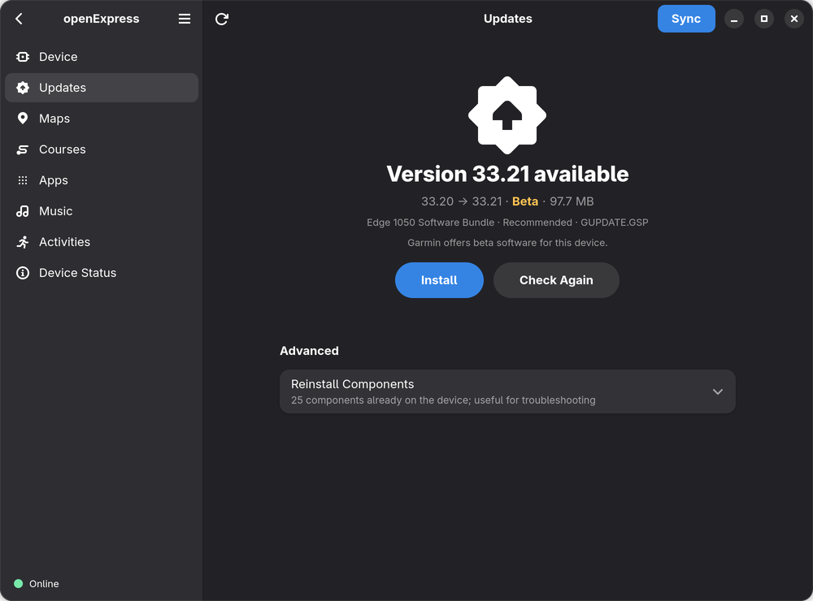
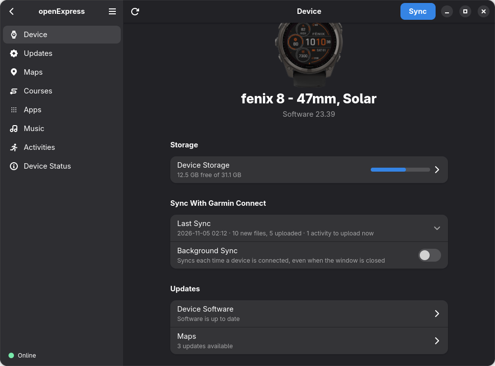
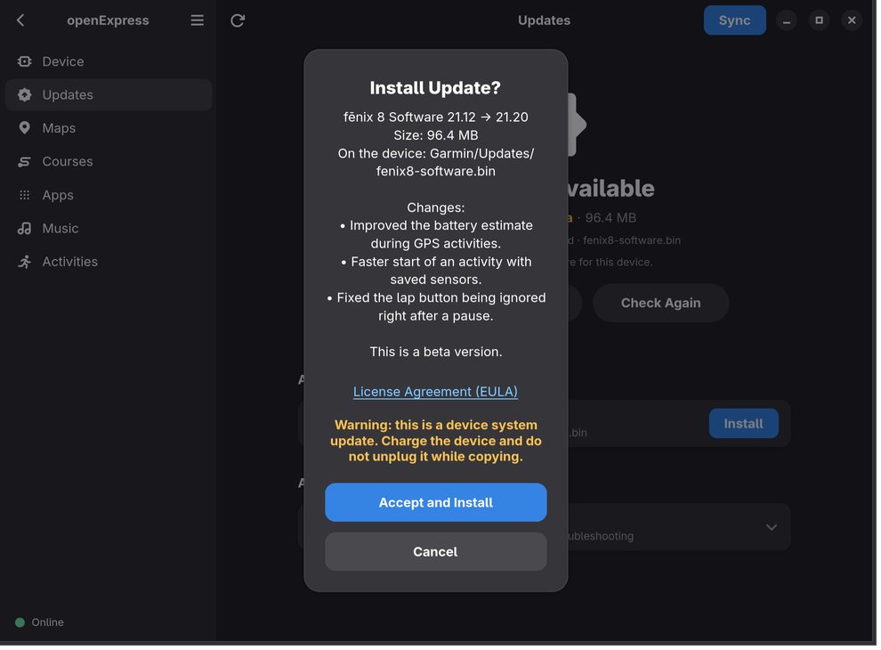
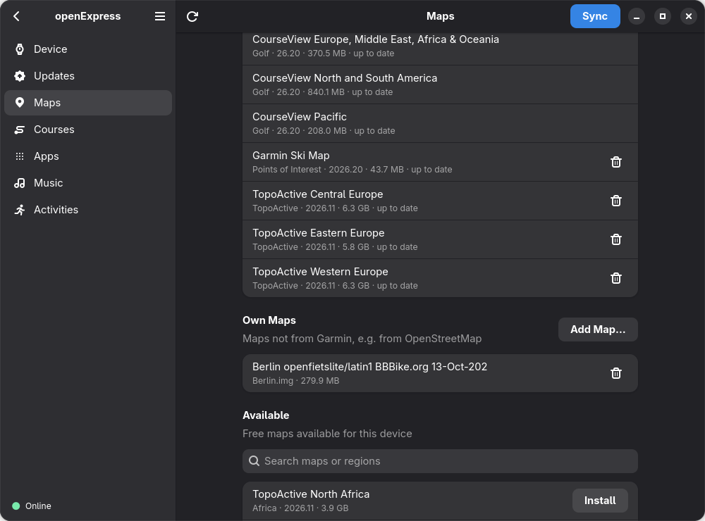
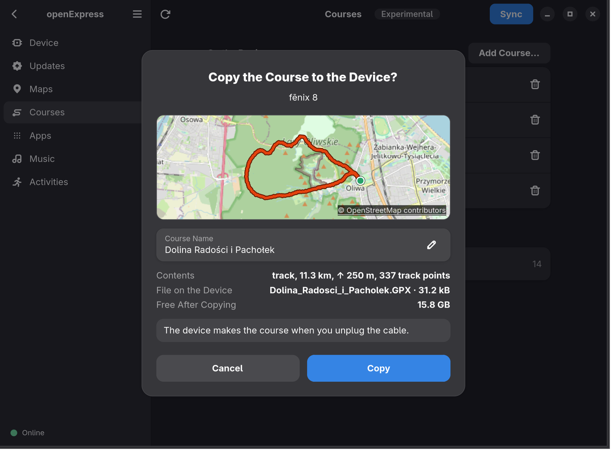
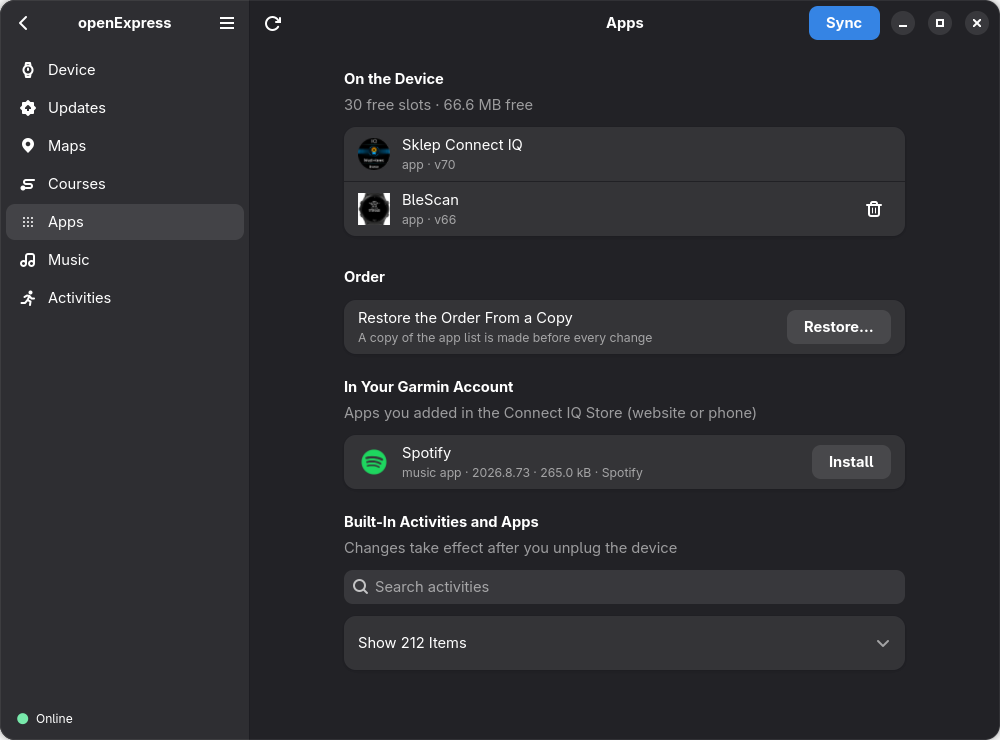
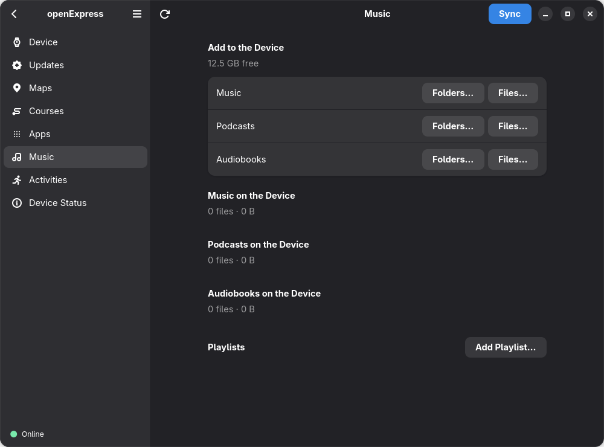
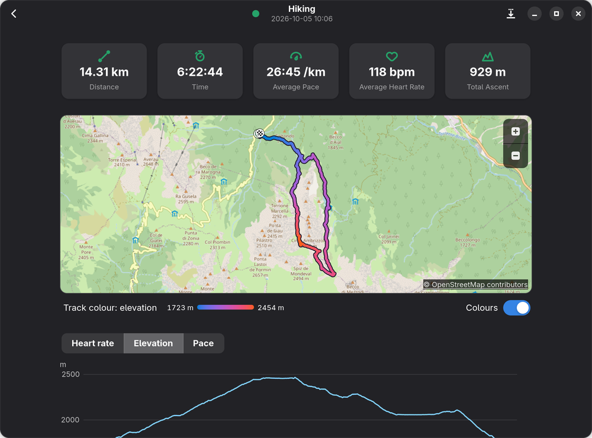
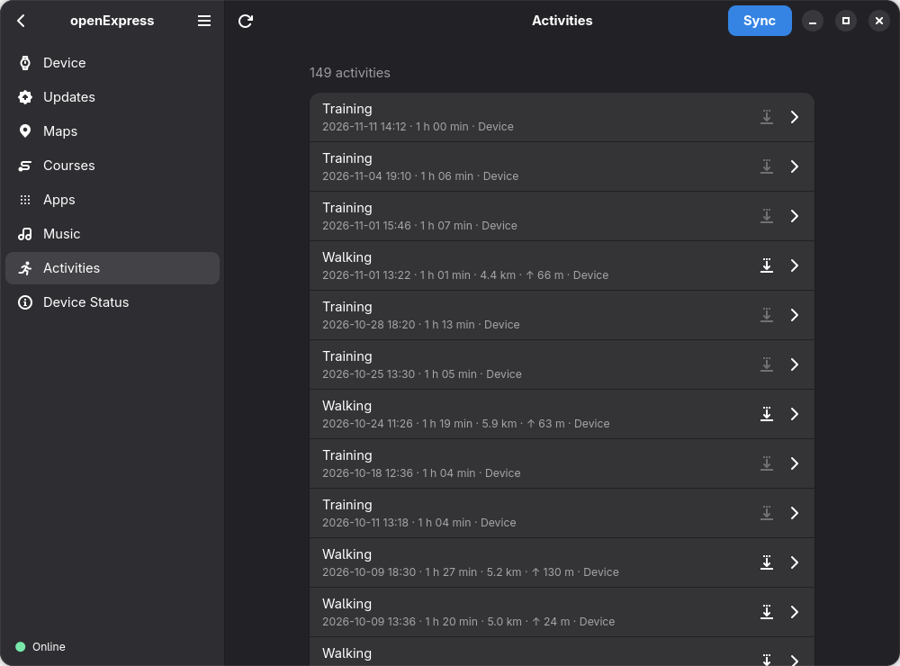

# Usage

## What openExpress does

**Status:** beta. The main features work and are tested on the devices listed in
[Supported devices](../README.md#supported-devices); other Garmin devices that connect over USB (MTP)
should work, but are untested – reports are welcome. Developed on Fedora/GNOME.

- Garmin Connect sync: new activities, sleep, HRV, metrics… are uploaded; courses, workouts
  and Connect IQ apps queued in Connect are written to the watch (on watches that hide their
  app folder, apps wait until you install them); TrueUp for multiple devices.
- Watch software updates and free maps (TopoActive, CourseView, Ski…), with MD5 verification.
  A map Garmin does not offer in the country of your Garmin account is not installed or
  updated, and the window and `openexpress maps` say why; the country is read from the
  account's profile (Garmin Express uses the computer's IP address), and without it (not
  signed in, a device of another account) such a map is only marked.
- Courses from GPX files (experimental): copied to the device, which turns them into courses when
  it is unplugged, listed and removed – without Garmin Connect ([Courses](#courses)).
- Connect IQ apps: install, update, remove, enable/disable built-in activities – also on
  watches that hide their app folder (e.g. the fēnix 8), without reordering your widgets.
- Music, podcasts and audiobooks with playlists.
- Activities of the watch and of its backups, each with its own page: the track on a map
  (streets from OpenStreetMap once you turn them on) coloured by heart rate, pace or elevation,
  charts, laps, heart rate zones, training effect and details; exported as GPX; what a FIT
  file holds (`openexpress fit inspect`).
- Backups; showing and setting the primary training device and the primary wearable;
  copies of the device's diagnostic files, kept on this computer.
- GTK 4 / libadwaita window, command-line tool and background sync with notifications.
- No telemetry. English, Polish and German; other languages are welcome
  ([Help translate](../README.md#help-translate)).

<p align="center">
  
</p>

## Not yet available

- Connect IQ app settings (the settings form is rendered by apps.garmin.com).
- Map updates for devices that connect as a USB drive
  ([USB modes](devices.md#usb-modes-mtp-and-mass-storage)), and for devices whose maps Garmin
  serves another way than its
  universal map service (the window and `openexpress maps` say so; the Maps page names
  the map update type Garmin gives the device, which helps a report).
- Checking the privacy-policy consents before a sync (the upload consent is checked, see
  [Privacy and security](privacy.md#privacy-and-security)).
- GPS satellite data (ephemerides), which Garmin Express writes to the watch when it syncs
  and which helps the watch find its position faster.
- Maps on a memory card: maps are installed and updated in the device's internal memory only.
- Installing software updates as part of a sync: they are installed only when you choose
  to, on the Updates page or with `openexpress updates --install`.
- Uploading ECG recordings: they go to Garmin Health, which needs a sign-in of its own that
  openExpress does not have. A sync leaves them on the watch and says how many there are.

## Setup

openExpress appears in your application menu. Setup needs the Garmin Express installer
**for Windows** (`GarminExpress.exe`, a free download from
[garmin.com](https://www.garmin.com/en-US/software/express/windows/)), also when you have
no Windows: openExpress only reads it and installs nothing. The installer for macOS does
not work. Connect the watch and open it: its page has a banner at the top. Click **Choose
Installer…** there and select the installer (at any time also in Preferences → Setup →
**Choose File…**), then **Sign In** in the same banner (or in Preferences; until the installer is
chosen, Preferences offers **Choose Installer…** there instead). No key needs to be created in
Garmin Connect. Turn on automatic sync on the
Device page (or in Preferences) to sync whenever the watch is connected.

## The start page and the device page

With one Garmin device connected, the window opens on its page; otherwise on the start page
(the picture at the top), which is also one step back from a device page: a tile for each
Garmin device connected, for those seen before and, once you are signed in, for the other
devices of your Garmin account (by their product name, never one you gave them); a tile
opens its device. A device with no picture yet shows the icon of its kind, smaller and dimmed
(a watch, a cycling computer, a handheld, a bike light or radar, a heart rate strap, a scale, a
blood pressure monitor, a speed or cadence sensor). The three buttons at the top of the main
menu (☰) choose how the tiles are laid out: **Automatic** (tiles, or a list for a section of
more than six devices), **Grid** or **List**. Up to two labels on a tile say
what is waiting and what the device is: **Update available**, or **Unplug to install** (an
update copied to the connected device, which installs it once unplugged; **Eject to install**
for a USB drive), **To sync** (activities on the device not uploaded yet) or **Never synced**
(by this installation: [each keeps its own](install.md#the-flatpak-and-the-version-from-source);
the version from source counts the Flatpak's syncs too),
**USB drive**, **Primary** (the account's **Primary Wearable**, as Garmin Connect names it:
steps and sleep come from this device), **Not on your account** and,
when nothing else needs saying, **Synced** (synced before, nothing new to upload). **To
sync** and **Synced** are there at once, as the last count found them (at most 7 days ago,
and only while nothing was synced since); the count that runs then confirms or changes them.
Labels of the account come from the account's list as it was last read (at most 7 days ago,
with the same sign-in). While you are not signed in the tiles show neither these labels nor
**To sync**, **Never synced** or **Synced**, and a sentence under the tiles says so; it also
says when the list could not be read (the tiles then keep what was known before). A Garmin
device that openExpress cannot use (it connects neither over MTP nor as a USB drive that
stays, such as the inReach Mini of the first generation) gets no tile: the notice on top of
the start page says **Device Not Supported**, with its name. The device page shows **Update available** or
**Update ready** under the software version too, and, under the account's **Primary training
device**, its **Primary Wearable** (only for a device that can be one; **Set as Primary**
makes it this device, after a question). Its
**Apps** and **Music** rows lead to their pages, as **Maps** does, and say how many there are
once those pages have read them; **Backup** says when the last backup was made and how many
there are (the folder in its tooltip). A backup copies the device's files as they are. A FIT
file the device wrote while it was connected over MTP may read cut short at first; the backup
then mounts the device again for a moment and reads the file once more, as a sync does ([Sync
details](#sync-details)). Only a file still cut short is left out, and the backup then says to
disconnect and reconnect the device and make it again.

A device seen before and not connected opens read-only: what was known of it when it was
last seen, its last sync with its details, what the last check of its updates found and
when (*Not checked since …* when that check is older than 30 days), and, while the
account's list is known, its **Primary Wearable**. **Forget Device…** at the bottom of that
page removes what this installation keeps of it (what was uploaded from it, its last sync, the maps of your own
copied to it and the copies of its diagnostic files); connected again, it is a new device, and its first sync asks again whether to
upload everything or new data only. While files of it are not uploaded yet, it is forgotten
only once you tick that they are discarded; its backups go only when you tick that too; nothing changes on the device or on your Garmin account. From the
command line: `openexpress devices --forget N`.

## Application window and background sync

```bash
openexpress gui                       # application window
openexpress install-desktop --apply   # "openExpress" menu entry and background service
systemctl --user daemon-reload
systemctl --user enable --now openexpress-watch.service
```

This is for the version from source. In the Flatpak, turn on **Background Sync** in Preferences
or on the device page; `install-desktop` does nothing there.

The background service syncs the watch every time it is connected and shows a notification.
Until you sign in it does nothing, and until the device's first sync (in the window, or with
`openexpress baseline --apply` or `openexpress sync --apply --all`) it only shows a
notification asking for it. The window and the service
never sync at the same time (shared lock). A watch that is not registered to the signed-in
account only gets a notification.

A watch that connects as a USB drive is synced with the **Sync** button (or
`openexpress sync`), never in the background, as over MTP:
its files uploaded and Garmin Connect's queue written to it (Connect IQ apps stay queued);
after a sync that wrote files to it the window asks to eject it, so that the watch takes them.
The device page says why a drive is not synced, when it is not
([USB modes](devices.md#usb-modes-mtp-and-mass-storage)).

The background service leaves devices in mass storage mode alone (such as the Varia RTL515):
it neither opens nor syncs them, and shows no notification about them. It syncs only when,
apart from those, exactly one Garmin device is connected; with two or more it writes a line
in the [log](troubleshooting.md#log-file) and does nothing. A watch and a Varia: the watch is synced.

<p align="center">
  
</p>

## Software updates

The Updates page (and `openexpress updates`) asks Garmin's update server what is new for the
connected device; no login is needed.

- **Status:** the top of the page says what is waiting: the new system version (with the
  installed one beside it), the name of the only update, how many updates there are, an update
  copied already that waits for the device, or that the software is up to date.
- **System updates are recognised by their file** (`GUPDATE.GSP`, `GUPDATE.GCD` in the
  device's top folder) and by the part number of the device as well as by what the server
  says: the server does not always mark them. The software of a part of the device (such as
  its GPS chip, which an Instinct 2S keeps in `GARMIN/REMOTESW/GUPDATE.GCD`) is shown with its
  own name and version, after the version the device lists for that part ("6.10 → 6.70"),
  never against the device's software; it is copied with the same care.
- **Beta versions** that Garmin offers to a device in its beta program are marked *Beta* in
  the window (for a system update at the top of the page and in the question) and `[BETA]`
  on the command line.
- **Before a system update** is copied, the window and `openexpress updates --install` warn
  to charge the device and not to disconnect it while copying. The question in the window
  shows both versions and links to the license (EULA).
- **Devices that lose their data on an update:** before every update of a device that Garmin
  files as one of these kinds (Wellness and Vivomove), the window and `openexpress updates
  --install` warn that the update erases the data stored on it and say to sync it first. The
  update is not held back. No such device has been tried yet.
- **After an update is copied** the device installs it when it is disconnected. Until then
  the page says *Update ready: disconnect the device to install it* (and how many more
  updates are available, if any), its tile *Unplug to install* (*Eject to install* for a USB
  drive), and `openexpress updates` says that the update waits for the device. The software
  counts as up to date only once the server offers the update no more: the device has
  reported the new version. A component counts as copied only when openExpress copied it;
  its file there otherwise is no update.
- **Two updates for one file of the device** are copied one at a time: the other one waits
  until the device has installed the first (the window shows when it can be installed, the
  command line says to disconnect the device and connect it again).
- **Install All**, shown when more than one update can be installed, asks once with the list
  and their size and copies them all in one go, then says what to do next.
- **An update copied before that the server offers again** was not installed by the device:
  the window says when it was copied and offers *Reinstall*, and says when the device changed
  or refused its file since (the same size, other bytes); `openexpress updates` says the same.
  openExpress keeps only the part number, the version and the time, until the server offers
  it no more.
- **On a USB drive** each file written is read back from the drive, not from the computer's
  cache, and compared with the server's checksum before the copy counts.
- **A device that connects as a USB drive** is ejected first: after the copy the window
  ejects it by itself, as `openexpress updates --install` does, and says that the cable can
  be unplugged only once that has worked; when the system refuses (a program still uses the
  drive), it says why and offers to try again. Some of these devices install an update only
  after a clean eject. Until it is unplugged, the window does not open a drive it ejected
  again. **Install All** ejects it once, after all of them.

Installing a system update was tested on an Edge 1050 (beta 33.12) and
reported working on a fēnix 7 ([#6](https://github.com/TomaszBojanowski/openExpress/issues/6)); component updates were tested on a Venu 2.

<p align="center">
  
</p>

## Maps of your own

Besides the maps Garmin offers, a device with maps also takes map files made by others, for
example from OpenStreetMap data (such as the Garmin `.img` downloads of BBBike.org).
openExpress lists these files on the Maps page and in `openexpress maps`, with the name that
is stored in the file.

- **Adding:** *Add Map…* on the Maps page, or `openexpress maps add FILE.img --apply`. The
  file keeps its name on the device; the name may have letters, digits, spaces and
  `. _ - ( )`, must start with a letter or digit and end in `.img`. `--name` gives it another
  one; in the window, rename the file first.
- **Nothing is overwritten:** a file that is already on the device is never replaced, and
  names that Garmin's own maps use are refused. Garmin's maps cannot be replaced or removed
  this way.
- **Removing:** the remove button on the Maps page, or
  `openexpress maps remove --own NAME --apply` for a map this installation copied. A map
  that was copied by hand or by another installation
  ([each keeps its own list](install.md#the-flatpak-and-the-version-from-source)) can be
  removed in the window after an extra question.
- **Where it works:** on devices that have a folder for maps (e.g. the fēnix 8), not on one
  in mass storage mode; a Venu 2 has none. Tested on a fēnix 8 with a map from BBBike.org,
  and reported working on a fēnix 7 ([#6](https://github.com/TomaszBojanowski/openExpress/issues/6)). openExpress checks that the file
  is a Garmin map file, not what is in the map.

<p align="center">
  
</p>

## Courses

*Experimental.* A watch or a bike computer turns GPX files copied to it over USB into courses,
without Garmin Connect. The Courses page, after Maps in the side panel, lists the courses on
the device, the files waiting for it and how many saved locations it keeps;
`openexpress courses` does the same on the [command line](cli.md).

- **Adding:** *Add Course…* on the Courses page, or `openexpress courses add FILE.gpx --apply`
  (without `--apply` it only says what it would copy). openExpress copies the file to the
  device's `GARMIN/NewFiles` folder, with the extension the device declares. **The device makes
  the course when you unplug the cable**, not before.
- **The question before a copy** shows a map of the file (the streets from OpenStreetMap once you
  turn them on, as on the page of an activity; without them the lines alone), the course's
  name, which you can change, what the file holds, its name on the device and the free space
  after copying. On the command line, `--name` changes the name. A file of several tracks or
  routes keeps their names, and the device turns each into a course; its waypoints become saved
  locations.
- **Waiting files:** until you unplug the device, a copied file is listed under *Waiting for the
  Device*, and a banner says to unplug it. A waiting file can be removed there, or with
  `openexpress courses remove`, before the device takes it.
- **Removing a course:** the remove button beside it, or
  `openexpress courses remove NAME --apply` (a part of the name is enough when only one course
  has it). The device keeps no other copy of a course; one from Garmin Connect can be sent
  again from there. openExpress never removes saved locations: remove them in the device's menu.
- **Where a course came from:** a chip beside its name says *openExpress* when the device turned
  a file openExpress copied into the course, and *Garmin Connect* for one sent from Garmin
  Connect; a course made another way has none.
- **The date** beside a course is the day its file was made: for a GPX file the device turned
  into a course, the day it did so; for a course from Garmin Connect, the day Garmin Connect made
  the file, when it sent the course to the device – not the day the course was created there.
- **The file's name on the device** is made from the course's name: plain Latin letters, `_` for
  spaces, at most 64 characters with the extension; a name already taken gets `_2`, `_3`…
  Nothing on the device is overwritten, and a copy or a removal is refused while a sync is
  running. In the Flatpak, `openexpress courses add` reads a file only from Downloads or from
  `Garmin` in your Documents folder; the window's file chooser reaches any file.
- **Where it works:** the page is shown for a device that declares GPX files in
  `GARMIN/NewFiles`. Copying, the device turning the copies into courses and their removal were
  tried on an Edge 1050 and a fēnix 8 ([Supported devices](devices.md)); other devices may
  treat GPX files differently, so the page carries the chip *experimental* – reports are welcome.

What courses from GPX files cannot do:

- **A route is straight lines.** A route (`<rte>` in the file) is a list of points that the
  device joins with straight lines, not along roads or paths; the question warns about it. For
  a course along roads, export a track instead.
- **The course's type is not carried over.** openExpress copies the GPX file as it is, and the
  Edge 1050 ignores the activity type a GPX file gives: its course is a generic one.
- **Points of interest** (`.gpi` files of Garmin's POI Loader) are not copied: Garmin's maps
  have their own.
- Only GPX files, up to 25 MB.

<p align="center">
  
</p>

## Connect IQ apps

- Some watches (e.g. the fēnix 8) keep their app folder out of the ordinary file listing.
  On such a device `apps install`, `apps update`, `apps remove` and the buttons in the window
  talk to it over a direct USB connection; the device disappears from the file manager for a
  moment and is mounted again afterwards. The device finishes the change after it is
  unplugged; until then the app is shown as waiting. A sync never does this: it leaves such
  apps in the queue. In the Flatpak this needs its USB permission (see
  [Flatpak permissions](../README.md#flatpak-permissions)).
- The apps already on the device keep their order and their on/off state: the app list is
  written back exactly as the device reported it, with only the requested change.
- Removing an app deletes its file and its settings file, on every device; the data the
  app saved on the device stays.
- Before every change to the apps (install, update, remove, enable/disable, order) a copy of
  the device's app list is saved next to the backups, in a folder named `GARMIN-APPS <date>`.
  Nothing is changed if the copy cannot be made. No new copy is made while the apps and their
  order are those of the newest copy; of copies with the same apps in the same order only the
  newest is kept, and the 10 newest copies of a device are kept: a new one takes the place of
  the oldest (full backups keep their newest 3 the same way).
- `openexpress apps order` (in the window: **Restore the Order From a Copy** on the Apps
  page, which lists only the copies in another order than now) lists these copies, each with
  how many apps would have to be moved, and puts the apps and widgets back in the order of
  the chosen one, for example after another program rearranged the widgets. It only reorders: the same
  apps, the same settings.
- An app that already waits in Garmin's queue for the device is not requested a second time.
- **Remove and Forget** in the window (`apps remove --forget`) also removes the app from your
  Garmin account's app list; **Remove** leaves it there.
- A device that has no app list yet (`GARMIN/APPS/OUT.BIN`, before its first app) shows *No
  Connect IQ apps on the device*; its apps are only queued in Garmin Connect ([#14](https://github.com/TomaszBojanowski/openExpress/issues/14)).
- An app whose version in the store asks for other permissions than before is installed or
  updated only once you allow them: the window lists them and asks, and `openexpress apps
  install` / `apps update` need `--allow-permissions`. A sync installs only what already
  waits in the queue, so it asks nothing.
- When a device refuses to create an app folder, it is not asked again until its software
  changes; the Apps page says so in one line, and apps that go there stay queued in Garmin
  Connect.

<p align="center">
  
</p>

## Music

The Music page (*Files…*, *Folders…*, *Add Playlist…*) and `openexpress music` copy music
(as Artist/Album), podcasts and audiobooks (by album) to the folders the device declares,
and write playlists as `.m3u8`. Files already on the device with the same size are skipped;
before copying, openExpress says which files on the device will be replaced. Files and
playlists can be removed (the trash button, `openexpress music remove`). In the Flatpak, the
tracks of a playlist can be read only from the Music and Downloads folders. Tested on a
fēnix 8.

<p align="center">
  
</p>

## Activities

The Activities page and `openexpress activities` list the activities of the connected device,
over MTP or as a USB drive, and of its backups (`Garmin/Backups` in your Documents folder, or
`--backups DIR`): the newest 30 first, then 30 more with **Show 30 More** (`--limit N`,
`--all`). Each has its sport, start, time (pauses left out), distance, ascent and where it was
read: the device, or the backup of a date for one the device no longer has. The page reads the
files when you open it, never when a device connects. A file the device was still writing
when it was connected says so (disconnect and reconnect the device, then open the page again),
as do a damaged file and a file that is no FIT file.

A click on an activity (or Enter) opens its page, which reads its file again. On top are its
distance, time, pace or speed, average heart rate and ascent (a workout without a distance: its
time, average and maximum heart rate, calories and ascent), each only when the file gives it.
An activity with positions has a map of its track, its start
and finish marked, the track coloured by what the chart shows: from blue (low, or a slow pace)
to red (high, or a fast pace), with the legend and the **Colours** switch under the map.
Streets and terrain come from OpenStreetMap only once you turn them on, with **Show the Map** or
in **Preferences → Activity maps** ([Privacy and security](privacy.md#privacy-and-security));
until then the track is drawn on a plain background. Ctrl + scroll or the buttons on the map
zoom it. The chart shows heart rate, elevation and pace or speed, one at a time, and the place
of its cursor is marked on the map. Under it come the laps (the watch's, or each kilometre
when the watch kept no laps): choose one to see it on the map and on the chart. Then the
heart rate zones as the watch worked them out, with the time in each; the training effect and
training load; and, in a row that opens, the details: elapsed and moving time, descent,
elevation, best pace, cadence, steps, heart rate, temperature and more, only those the file
gives. The moving time, the average moving pace, the temperatures with their decimal, the rest
time of a strength workout and the kilometres of an activity without the watch's own laps are
worked out by openExpress from what the watch recorded, so they may differ slightly from Garmin
Connect's; the other values come from the summary the watch wrote into its file.

<p align="center">
  
</p>

The export button of an activity, or `openexpress activities export NAME… --apply`, writes it
as a GPX 1.1 file named `YYYY-MM-DD HH.MM Sport.gpx`: each point with its position, elevation
and time, nothing else (no heart rate, no device, no serial number). The window asks where to
save it; the command line writes to `Garmin/GPX` in your Documents folder (or `--dest DIR`)
and never overwrites a file. An activity without GPS positions (a pool swim, strength
training) has no GPX.

`openexpress fit inspect FILE` tells what any FIT file on this computer holds: its type,
manufacturer, product and creation time, its messages and whether it is whole. Tested on a
fēnix 8 over MTP.

<p align="center">
  
</p>

## Sync details

- The watch must be registered to the Garmin account you are signed in to. Before every sync
  and every Connect IQ operation the account's device list is fetched from Garmin Connect;
  if the watch is not on it, or the list cannot be fetched, nothing is uploaded and nothing
  is written to the watch. `openexpress baseline` needs a login too. Features
  without the account (backup, software updates, maps, music) work with any watch.
- **Adding a device to the account (experimental).** A device the account does not list can be
  added from openExpress, as Garmin Express adds one: **Add to Account…** on the banner or on
  the device page, or `openexpress register` (a trial run; `--apply` adds it). A question
  names the device and the account first. openExpress sends Garmin the device's
  `GarminDevice.xml` and adds it as an active device (one Garmin keeps as retired is made
  active), then reads the account's list again to check. Garmin refuses a device of another
  account; its owner has to remove it there first. Nothing is written to the device, and its
  primary training device is not changed. A device is removed from an account only in Garmin
  Connect.
- **TrueUp** (`FIT_TYPE_39`): when you own several Garmin devices, Connect asks the client to
  check back after a delay and then sends adjusted daily totals, which are written to the
  watch. As in Garmin Express, openExpress waits the whole delay when it is under five
  minutes and 90 s otherwise, at most three times; the window and the command line show how
  much of the wait has passed. **Stop Waiting** in the window, or Ctrl+C on the command line
  during the wait, stops it: the sync ends as usual,
  nothing of TrueUp is written, and it comes with the next sync.
- **Connect IQ** apps queued for the watch (e.g. chosen in the store on your phone) are
  installed during sync, except on devices that hide their app folder, where they stay
  queued ([Connect IQ apps](#connect-iq-apps)). New watch faces are installed but not
  activated, like
  in Garmin Express.
- The dry run (`openexpress sync` without `--apply`) also says what each file waiting in
  Garmin Connect is before a sync writes it to the watch – a workout's sport, name and steps,
  a course's sport and name, a schedule's days – who made it, and whether it is whole. It
  downloads them into memory only and acknowledges nothing, so the sync downloads them again.
  Tested on a fēnix 8 over MTP.
- Garmin Connect also forwards the measurements of one device to your others (a file such a
  device made). The dry run says who made each file (another device of your account by its
  name, "this device", Garmin Connect), and the program's log says it for each file a sync
  writes to the device.
- A FIT file the device wrote while it was connected over MTP (a Garmin Coach plan, for
  example) may read cut short: gvfs keeps the size the file had when it was first looked at.
  At the first such file a sync mounts the device again for a moment, which gives fresh
  sizes, and reads the file once more; once a sync. The progress says *Refreshing the
  device's files…*, and the device leaves the file manager for that moment. A file still cut
  short is not uploaded: the summary says so, and the next sync reads it again. If the device
  is not mounted again, the sync stops and says to unplug it and plug it in again. A device
  connected as a USB drive needs none of this.
- **Last Sync** on the Device page, `openexpress sync` and the notification of the
  background sync use the same words for how many new files the device had, how many were
  uploaded and how many came from Garmin Connect; the row on the Device page also says when
  it was. On the Device page and in `openexpress status` it ends, apart from what that sync
  found, with how many activities the connected device has to upload now (*now to upload: 2
  activities*), and says *Never synced* for a device this installation has not synced yet,
  as its tile does. The details name the new
  files by their type (activities, sleep, HRV status, device log…; others as "other data"),
  and the files from Garmin Connect too (TrueUp and Connect IQ apps have lines of their own),
  say how many Garmin Connect already had, and warn when Garmin rejected a file, a file could
  not be uploaded, or another step failed (a file from Garmin Connect, a Connect IQ app,
  TrueUp).
- The Flatpak and the version from source keep their own records of what they uploaded.
  The version from source reads the Flatpak's too, so a file the Flatpak uploaded is not
  uploaded again from source ([details](install.md#the-flatpak-and-the-version-from-source));
  a file the version from source uploaded is new to the Flatpak, and Garmin Connect recognises
  it as a duplicate.

## A device that stops responding

Over MTP a device can stop answering in the middle of a read: its MTP session hangs while the
cable and USB are fine, and a program waiting for it would wait for ever. openExpress waits at
most 30 s for each answer of the device (a part of a folder's listing, a part of a file, a
file's size and time, the free space). The time counts from the last answer, so a large file that comes
steadily is read whole, however long it takes. With no answer by then the operation ends with
*The device stopped responding. Unplug it and plug it in again.*, and nothing more is asked of
that device until it is unplugged, as its connection (gvfs) stays blocked:

- A sync stops. The files it uploaded before stay uploaded; a file from Garmin Connect that was
  not written to the device is not acknowledged, so it comes again with the next sync. A backup
  leaves no partial folder. The command line says it once and ends with exit code 1.
- The window shows a banner with the device's name on the start page and on the device page,
  closes the device, and does not open it again while it stays plugged in; other devices
  connected work as usual. The banner goes once the device is unplugged, or restarts.

Unplug the cable and plug it in again: that ends the hung session in the device. A window
started again before that finds out at its first read of the device, after about 35 s. Writing
to the device has no such limit; after a stall a write fails at once. The
[log](troubleshooting.md#log-file) says how long the device had been idle before it stopped, how
long its connection had been open and whether openExpress had mounted the device, never a file
name; an answer that took more than 5 s is noted too.

## Configuration

### Languages

The interface is available in English, Polish and German. The language follows the system
locale; you can override it:

- in the window: main menu (☰) → Preferences → Language,
- for one command: `openexpress --lang pl …` or `OPENEXPRESS_LANG=pl`,
- permanently: `openexpress setup --ui-language pl` (`system` restores the default).

Garmin's sign-in page and the answers of its servers use the same language; `openexpress
setup --locale de_DE` sets another one for them.

### Cache

Downloaded maps and software updates, device pictures and app icons, and files on their way to
the device are kept in `~/.cache/openexpress` (the Flatpak: `~/.var/app/io.github.tomaszbojanowski.OpenExpress/cache/openexpress`;
each installation has its own), in six parts: `maps`, `updates`, `pictures`, `answers` (what
Garmin's servers answered a moment ago: see [Privacy and security](privacy.md#privacy-and-security)),
`tiles` (the tiles of OpenStreetMap under the maps of activities, once they are turned on) and
`temp`.
`openexpress cache` shows how big each part is, `openexpress cache --clear --apply` empties all of
them except the pictures of the devices openExpress remembers (`--only pictures` deletes those
too) and `openexpress cache --clear --only maps,updates --apply` only those named (without
`--apply` it says what it would free). In the window, Preferences → Storage has a row for each
part with a trash button, and **Clear All…**; maps, updates and **Clear All…** ask first. Maps are then downloaded
again when they are installed or updated. Nothing is cleared while a download, an install or a
copy to the device is running.
